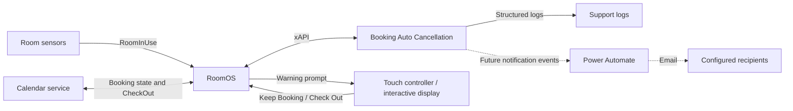
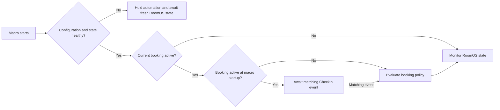
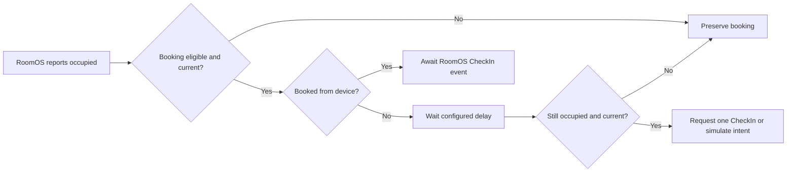
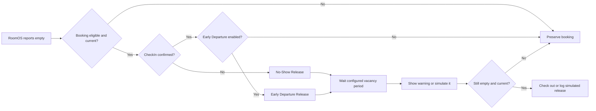

# Booking Auto Cancellation Architecture Context And Solution Proposal (Draft)

## 1. Document Purpose

This document supplies technical and operational input for Enterprise Architecture Context and formal High-Level Design (HLD) development. It presents a proposed solution direction, its safety constraints, dependencies, and implementation evidence. It is not the final HLD or approval to deploy automatic booking actions.

It intentionally does not reproduce every state transition or test case. Supporting technical specification, operational procedure, implementation, and automated test evidence are maintained as controlled engineering artefacts.

## 2. Approval Scope

**Architecture review decisions:**

| Decision needed | Proposed position | Accountable decision owner |
| --- | --- | --- |
| Problem and outcomes | Reduce unused booked-room time without accepting unproven release risk; measure pilot outcomes before scale-out. | Room service owner |
| Solution direction | Use a RoomOS macro for a single-room, current-booking pilot. RoomOS and the calendar service remain authoritative. | Enterprise Architect and RoomOS platform owner |
| Release policy | Permit only identity-bound, fail-closed CheckIn and CheckOut with an actionable warning surface. Approve timings, long-meeting handling, and early-departure policy separately. | Room service owner |
| External notifications | Defer Power Automate/email integration to a separate architecture, security, privacy, and operating-model decision. | Enterprise Architect and security owner |

**In scope:**

- Current-booking management on a single RoomOS device.
- No-Show Release for a qualifying, empty current booking.
- Optional Early Departure Release after confirmed CheckIn and later vacancy.
- Automatic CheckIn for a qualifying occupied current-session booking.
- Operator-visible warnings, confirmation, observability, dry-run rollout, and bounded recovery.

**Out of scope:**

- Creating, editing, or deleting calendar records.
- Managing future bookings or bookings on other rooms.
- Replacing RoomOS sensor fusion, calendar platforms, or native RoomOS booking services.
- Inferring physical occupancy independently of RoomOS `RoomInUse`.
- Direct SMTP, recipient lookup, email templates, and external HTTP calls in the current macro. The planned Power Automate capability is not implemented yet.

## 3. Business Context

Meeting rooms can remain reserved while unused, reducing available capacity. A release mechanism must improve utilization without risking the cancellation of an occupied or otherwise uncertain meeting.

The macro therefore follows a conservative policy:

```text
Prove current booking identity, room state, configuration health, and release safety.
Only then allow an automatic booking action.
Otherwise preserve the booking.
```

The booking service remains the calendar authority. The macro never calls `Bookings.Delete`; it requests `Bookings.CheckOut` only when its safeguards permit release.

## 4. System Context And Boundaries



### Trust Boundaries

| Boundary | Source of truth | Macro responsibility |
| --- | --- | --- |
| Room occupancy | RoomOS `RoomAnalytics.RoomInUse` | Consume `True`, `False`, or unknown. Never infer occupancy from calls or local timers. |
| Booking state | RoomOS Bookings status and commands | Treat active booking ID and end time as authoritative and current only after validation. |
| Calendar state | Booking service behind RoomOS | Request CheckOut through RoomOS; never directly edit or delete calendar data. |
| User intent | Actionable RoomOS prompt response | Require prompt ownership and the confirmation guard before a user-initiated CheckOut. |
| Operational policy | Version-controlled macro `CONFIG` | Apply approved timings and feature settings at runtime. |

## 5. Architectural Decisions

| Decision | Rationale | Consequence |
| --- | --- | --- |
| Fail closed on uncertainty. | A false release is worse than a missed release. | Missing, stale, malformed, failed, or mismatched input preserves the booking. |
| Use RoomOS as the source of truth. | Booking and sensor state may change outside the macro. | Local state is transient workflow ownership, not an independent booking record. |
| Use `Bookings.CheckOut`, never `Bookings.Delete`. | CheckOut allows the booking service to remain authoritative. | No automatic deletion fallback exists. |
| Keep runtime state in memory. | The macro needs only current workflow state and should not persist stale booking data. | Restarting during an active booking triggers a conservative startup quarantine. |
| Bound retries and avoid polling. | Protects RoomOS xAPI resources and avoids indefinite automation. | Only the configured readiness-recovery schedule retries transient readiness failures. |
| Require an actionable live warning surface for automatic release. | Occupants need an opportunity to preserve a meeting. | Informational OSD-only rooms do not automatically CheckOut. |
| Separate dry run from live command execution. | Enables controlled validation before real release. | Dry run simulates booking actions but still establishes required device safety configuration. |
| Defer external notification integration. | Recipient resolution, templates, delivery, audit, and credentials need separate enterprise design. | The current macro has no external HTTP or email capability. |

## 6. Logical Components

| Component | Responsibility | Key outputs |
| --- | --- | --- |
| Configuration bootstrap | Applies required RoomAnalytics and native CheckIn safety settings. | Configuration health, RoomOS capability errors. |
| Booking reconciler | Reads and reconciles availability, booking ID, timestamp, and booking details. | Current booking snapshot and identity-bound policy decision. |
| Presence adapter | Converts `RoomInUse` into occupied, empty, or unknown. | Validated room-use state and recovery trigger. |
| Policy engine | Determines whether autocancellation is `Allowed` or `Blocked`; classifies long and unclassifiable meetings. | Native CheckIn policy and eligibility. |
| Automatic CheckIn coordinator | Schedules one current-session CheckIn attempt and handles native event races. | CheckIn command or dry-run simulated confirmation. |
| Release workflow coordinator | Selects No-Show or Early Departure policy and controls countdown, warning, expiry, and final validation. | CheckOut request or safe cancellation. |
| Prompt-surface manager | Detects controller capability, routes prompts, tracks ownership, and handles delayed display or dismissal. | Actionable-warning authorization. |
| Recovery and health scheduler | Reconciles transient blockers and schedules a local-midnight health check. | Restored readiness or an explicit suspended state. |
| Observability layer | Routes structured, safe logs by event type and severity. | Searchable rollout, release, and failure evidence. |
| Deferred notification integration | Future Power Automate/email capability, outside the current release. | Requires a separate approved integration design. |

## 7. Domain Model And State Ownership

The macro maintains transient state for one current booking lifecycle.

| State | Meaning | Owner and lifetime |
| --- | --- | --- |
| Lifecycle and workflow IDs | Monotonic identifiers for the current booking and each countdown/warning attempt. | The booking ID changes when a booking changes or ends; the workflow ID changes when an attempt is cancelled or restarted. |
| Current booking snapshot | Active booking ID, end time, start time, availability state, and booked-from-device flag. | Rebuilt from RoomOS and invalidated on lifecycle change. |
| Presence and policy | `Occupied`, `Empty`, or `Unknown`, plus `Allowed` or `Blocked` with a reason. | Presence comes from `RoomInUse`; the policy is bound to booking identity and end timestamp. Unknown presence is unsafe. |
| CheckIn state | RoomOS confirmation, pending event, dry-run simulation, and one-attempt guard. | Scoped to the current booking lifecycle. |
| Prompt state | Phase, expiry, controller/OSD ownership, alert timers, and confirmation guard. | Scoped to the release workflow. |

The macro does not persist this state. A stale asynchronous read, timer, prompt completion, or command completion is discarded when its captured lifecycle or workflow identifiers no longer match.

## 8. End-To-End Workflow

### 8.1 Startup And Readiness



An active booking found during startup is not assumed to be unchecked in. It remains blocked until RoomOS supplies a matching CheckIn event. This prevents a macro restart from releasing an ongoing meeting.

### 8.2 Occupied Booking And Automatic CheckIn



Only one automatic CheckIn attempt is made per booking lifecycle. A matching RoomOS `CheckedIn` event suppresses the scheduled attempt. A failed CheckIn does not, by itself, make an otherwise valid empty-room release unsafe.

### 8.3 Empty-Room Release



Fresh automatic-release validation confirms, at minimum, current lifecycle and workflow ownership, active availability, booking identity, a future end time, confirmed empty presence, healthy policy, and a verified short meeting when the long-meeting exemption is enabled. Production also requires a successfully displayed actionable warning surface.

### 8.4 Occupancy, User Interaction, And External Change

- Occupancy before a visible warning cancels the release workflow and may schedule automatic CheckIn.
- Occupancy during a visible production warning keeps the warning available for user action. Expiry detects the occupied state and preserves the booking.
- `Keep Booking` cancels the warning, revalidates presence, and can start a fresh countdown only if the room remains empty and eligible.
- `Check Out` requires a separate confirmation response before the macro issues a user-initiated CheckOut.
- A `Free` or `FreeUntil` transition, booking rollover, unknown presence, failed health check, or stale callback cancels the old workflow.
- An externally released booking is observed and logged; the macro does not attempt a duplicate CheckOut or Delete.

### 8.5 Deferred Notification Integration

Power Automate/email notifications are not part of this release. A future proposal may publish a warning-displayed or successful macro-CheckOut event, but only after separate endpoint, credential, privacy, recipient, audit-retention, failure-isolation, and duplicate-delivery decisions. It must remain notification-only and cannot influence booking safety decisions.

## 9. Interfaces

### RoomOS Inputs

| Interface | Use |
| --- | --- |
| `Status.RoomAnalytics.RoomInUse` | Occupancy source of truth. |
| `Status.Bookings.Availability.Status` and `TimeStamp` | Determines whether a current booking exists and its end time. |
| `Status.Bookings.Current.Id` | Identifies the booking commands may affect. |
| `Status.Time.SystemTime` | Supplies codec-local timezone for midnight health scheduling. |
| `Status.Peripherals.ConnectedDevice` | Identifies controller-mode TouchPanel Navigators. |
| `Status.SystemUnit.ProductPlatform` | Determines supported interactive OSD capability. |
| `Event.Bookings.CheckedIn` | Confirms RoomOS, user, or ad-hoc CheckIn. |
| `Event.UserInterface.Message.Prompt.Response` and `Prompt.Cleared` | Captures user intent and prompt lifecycle. |

### RoomOS Outputs

| Interface | Use |
| --- | --- |
| RoomAnalytics configuration writes | Establishes the required presence pipeline. |
| `Bookings.CheckIn.WindowDuration` and `Bookings.CheckIn.Enabled` | Prevents native no-show policy from racing macro safety policy. |
| `Bookings.Get` and recovery `Bookings.List` | Verifies current booking identity and schedule. |
| `Bookings.CheckIn` | Performs one eligible automatic CheckIn in live mode. |
| `Bookings.CheckOut` | Releases an eligible booking in live mode. |
| Prompt display and clear commands | Provides warning and confirmation interactions. |
| Audio volume and sound commands | Provides optional warning alerts. |
| Codec logging | Supplies operational evidence and incident diagnostics. |

No HTTP client, external credentials, database, or persistent store is used by the current implementation.

## 10. Safety, Resilience, And Failure Handling

### Safety Controls

| Risk | Control |
| --- | --- |
| Releasing the wrong booking | Bind decisions, timers, commands, and callbacks to the current booking lifecycle and booking ID. |
| Releasing an occupied room | Require `RoomInUse = False` at final release validation; unknown presence fails closed. |
| Releasing a long or malformed meeting | Verify booking details and block long or unclassifiable current bookings. |
| Restarting during an active meeting | Apply startup CheckIn quarantine until a matching RoomOS event is observed. |
| Prompt delivered to an unusable surface | Require an actionable, successfully displayed production warning surface for automatic release. |
| Event, timer, or command race | Use lifecycle/workflow generations and freshness checks before committing effects. |
| Native RoomOS no-show policy racing the macro | Set a native CheckIn window longer than the macro release horizon and control native CheckIn state. |
| Failed CheckOut causing destructive fallback | Preserve the booking, record `CheckOutFailed`, and never call Delete. |
| Retry loop affecting device stability | Bound readiness recovery by configured delays; no unbounded polling. |

### Recovery Model

The macro stays subscribed to RoomOS events even while blocked. A transient failure can be reconsidered through a bounded readiness-recovery sequence, a later relevant status event, or a local-midnight health check.

The macro does not retry booking-changing commands without a new lifecycle or explicit workflow path. In particular, an automatic CheckIn is attempted at most once per lifecycle, and a failed CheckOut blocks automatic booking actions for that lifecycle.

## 11. Security And Data Handling

- The current macro uses RoomOS xAPI only and has no embedded credentials, external authentication tokens, or HTTP integration.
- It stores only transient runtime state required to manage the current workflow.
- It uses booking data only to verify identity and schedule; it does not persist or log attendee names, meeting subject/body, room audio, or raw sensor data.
- Operational logs include booking identity and, when verified, schedule timestamps. Logging formats errors safely and does not serialize arbitrary raw xAPI responses.
- Access to macro source, configuration, deployment, and codec logs must follow the organization's existing room-administration and logging access controls.

## 12. Operational Model

### Dry Run

Dry run is the rollout control. It suppresses macro booking commands, prompt display/clear, and audio while performing normal validation and emitting simulated intents. It still configures the RoomAnalytics pipeline, CheckIn window, and native CheckIn safety baseline.

The dry-run evidence required before production enablement includes:

- Expected booking IDs and timing in `[DRY RUN - WOULD_DISPLAY_PROMPT]` and `[DRY RUN - WOULD_RELEASE]` logs.
- No macro `Bookings.CheckIn` or `Bookings.CheckOut` command.
- No macro prompt or audio command.
- Confirmed handling of occupancy, unsupported/unknown inputs, external release, and booking rollover.

### Production Enablement

Production enablement requires successful dry-run review, a supervised release test, and confirmation that the macro sends only one `Bookings.CheckOut` for the correct current booking. The configuration and room topology must be revalidated after significant RoomOS, calendar, Navigator, or sensor changes.

## 13. Dependencies And Assumptions

| Dependency or assumption | Governance relevance |
| --- | --- |
| RoomOS supports the required Bookings, RoomAnalytics, Peripherals, Time, Audio, and UI xAPI nodes. | Unsupported or denied nodes fail closed; room compatibility must be validated. |
| RoomOS `RoomInUse` is a suitable occupancy signal for the room. | Physical sensor quality is a hardware acceptance responsibility. |
| Calendar integration correctly exposes the current booking through RoomOS. | The macro cannot compensate for missing or incorrect upstream booking data. |
| Controller topology or supported interactive OSD is available for live automatic release. | Without an actionable surface, automatic release remains blocked. |
| The native CheckIn window is configured longer than the macro release horizon. | Prevents competing automated no-show behavior. |
| The codec provides a valid timezone offset. | Required for safe midnight health scheduling. |

## 14. Risks And Mitigations

| Risk | Mitigation | Residual risk |
| --- | --- | --- |
| Sensor false negative causes a warning while people are present. | Visible user warning, actionable Keep Booking control, and final presence revalidation. | Physical sensor accuracy cannot be proven by unit tests. |
| Calendar or RoomOS state is delayed or unavailable. | Identity-bound snapshots, freshness checks, bounded recovery, and fail-closed behavior. | The booking may remain reserved longer than desired. |
| Macro restart occurs during a meeting. | Startup quarantine requires matching CheckIn provenance. | Existing meetings may remain unmanaged until RoomOS CheckIn is observed. |
| Controller disconnects during warning. | Refresh topology, preserve deadline, and block automatic release without another actionable surface. | Release may be skipped. |
| External automation releases a booking first. | Detect `Free`/`FreeUntil`, cancel local work, log external release, and send no duplicate action. | External policy remains outside macro control. |
| Configuration change creates unsafe timing. | Explicit deployment constraints, dry-run rollout, and unit coverage. | Governance and change discipline are required. |

## 15. Verification And Governance Evidence

| Evidence | Purpose |
| --- | --- |
| Technical specification | Detailed functional, safety, asynchronous, recovery, and edge-case contract. |
| Operational procedure | Deployment, configuration, monitoring, troubleshooting, and operational guidance. |
| Automated regression suite | Lifecycle, race, UI, configuration, and release behavior verified with mocked xAPI and fake timers. |
| Codec dry-run checklist in the technical specification | Validates RoomOS/hardware behavior that VM tests cannot prove. |
| Supervised live release | Confirms correct production RoomOS command behavior before broad enablement. |

Changes require review when they alter any of the following: booking command eligibility, RoomOS configuration writes, prompt authorization, timing relationships, sensor inputs, retry boundaries, log evidence, notification contracts, endpoint security, or the fail-closed policy.

## 16. Traceability

- Operational configuration and troubleshooting are defined in the operational procedure.
- Detailed technical requirements, state transitions, test inventory, and codec checklist are defined in the technical specification.
- The runtime implementation and executable regression suite are maintained in the controlled Bitbucket repository.

The governing invariant remains unchanged across all artifacts: when safety cannot be proven, the booking is preserved and no automatic booking-changing action is taken.
