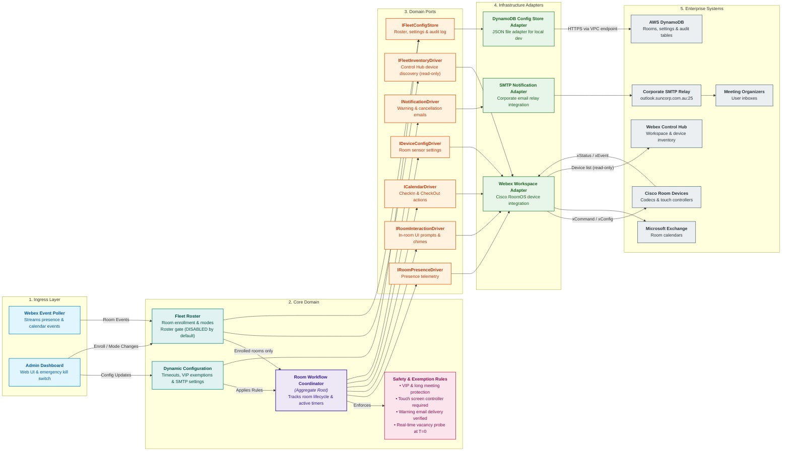

# Service Domain Driven Design

## 1. Overview

This document specifies the Domain-Driven Design (DDD) model and Hexagonal (Ports and Adapters) architecture for the external Booking Auto Cancellation service.

The service manages meeting room reservation lifecycles across ~800 meeting spaces, decoupling physical presence telemetry, in-room user interactions, calendar commands, and end-user email notifications behind clean architectural seams while enforcing strict fail-closed safety invariants.

---

## 2. Domain-Driven Design Architecture Diagram

---

## 3. Detailed Component Responsibilities

### 3.1 Driving Ingress Layer & Configuration Sources

- **`LongPollingTransport`**: Outbound HTTPS 443 persistent connection to Webex Cloud integration queues. Ingests occupancy telemetry (`RoomAnalytics.RoomInUse`), calendar availability (`Bookings.Availability`), booking details, and touch controller user interactions without requiring inbound firewall pinholes, public DNS, or reverse proxies.
- **`AdminDashboardController`**: Fastify-embedded `/admin` web interface providing a 1-click fleet Emergency Kill Switch, real-time room search, and live configuration updates for timeouts, VIP lists, and SMTP relay settings.
- **`ConfigSources`**: Secrets (Webex credentials) come from AWS SSM Parameter Store (`SecureString`) or `.env.local`. All admin-controlled state (the roster, room modes, the kill switch, timings, exemptions, and SMTP settings) is loaded from and persisted to the durable fleet configuration store (DynamoDB in AWS, a JSON file on a laptop), so dashboard changes survive restarts. The `AUTOCANCEL_KILL_SWITCH` parameter remains as an independent, second kill-switch source ([ServiceLowLevelDesign.md §8](ServiceLowLevelDesign.md)).

### 3.2 Dynamic Fleet Configuration Model

- **Timing Thresholds**: `EMPTY_ROOM_TIMEOUT_MS` (default 10m), `PRE_TIMEOUT_WARNING_MS` (default 5m), `POST_TIMEOUT_GRACE_PERIOD_MS` (default 2m), `AUTOMATIC_CHECK_IN_DELAY_MS` (3s), `BOOKING_SYNC_COALESCE_DELAY_MS` (50ms), and `BOOKING_READINESS_RECOVERY_DELAYS_MS` (`[250, 500, 1000, 2000, 4000]`).
- **Room Policy Parity Settings** (same meaning and defaults as the macro `CONFIG`): `EARLY_DEPARTURE_RELEASE_ENABLED` (default `false`), `NATIVE_CHECK_IN_WINDOW_MINUTES` (default 60; must exceed the effective release horizon), and `ULTRASOUND_SENSOR_ENABLED` (default `false`; writes `PeoplePresence.Input.Ultrasound` `On`/`Off`).
- **Exemption Rules**: `LONG_MEETING_EXEMPTION_THRESHOLD_MS` (120m), `EXEMPT_ORGANIZERS` (VIP email list), and `EXEMPT_TITLE_KEYWORDS` (e.g. "Board", "Executive", "Confidential").
- **SMTP & Notification Settings**: `NOTIFICATIONS_ENABLED` (boolean), `SMTP_HOST` (`outlook.suncorp.com.au`), `SMTP_PORT` (25), `SMTP_FROM`, and `SMTP_SECURE`.
- **Safety & Rollout Modes**: `AUTOCANCEL_KILL_SWITCH`, fleet anomaly spike threshold (>30 releases / 5 min), and per-room operational mode (`DISABLED`, `MONITOR_ONLY`, `DRY_RUN`, `LIVE`).

### 3.2a Fleet Roster (Enrollment Authority)

- Owns the answer to "which rooms does this service manage, and how". Every workspace discovered in Control Hub gets a roster entry in `DISABLED` mode. A `DISABLED` room has no actor, and all of its events are discarded at the roster gate.
- Only an administrator can promote a room: `DISABLED → MONITOR_ONLY → DRY_RUN → LIVE` (or `DISABLED → DRY_RUN`). `LIVE` is reachable only from `DRY_RUN`, after a readiness report and an explicit, audited confirmation. The system may only demote a room, for example to `DISABLED` when its managed device is replaced.
- Binds each workspace to exactly one managed device. A replaced or ambiguous device is never touched until an admin re-enrolls it.
- Enforces the roster gate on both ingress events and outbound device commands.
- Details: [ServiceLowLevelDesign.md §5.7, §7.1 and §8](ServiceLowLevelDesign.md).

### 3.3 Aggregate Root: RoomActor (`RoomWorkflowCoordinator`)

- Manages an isolated in-memory Finite State Machine for each physical room across 7 lifecycle phases: `Idle`, `Quarantined`, `ActiveMeeting`, `CountdownScheduled`, `PromptVisible`, `ValidatingJIT`, and `Released`.
- **Generational Identity Counters**: Increments `bookingLifecycleId` on every meeting transition and `releaseWorkflowId` on every release attempt to cleanly reject stale, out-of-order asynchronous events.
- **Workflow State**: Tracks `warningEmailSent` status, `promptRestorationCount`, and manages active timers (countdown, grace period, and 60-second recurring audio chime loop).

### 3.4 Domain Policies (Business Logic)

- **`MeetingExemptionPolicy`**: Classifies meetings longer than `LONG_MEETING_EXEMPTION_THRESHOLD_MS` or matching `EXEMPT_ORGANIZERS` / `EXEMPT_TITLE_KEYWORDS` as exempt. Serializes commands to set `Bookings.CheckIn.Enabled: False` via a FIFO queue to protect exempt meetings from native RoomOS auto-release.
- **`StartupQuarantinePolicy`**: Quarantines meetings underway when the service initializes or restarts (`AwaitingStartupCheckIn`). Strictly prevents auto-cancellation until fresh in-room occupancy and check-in confirmation are observed.
- **`WarningNotificationPolicy`**: Calculates remaining countdown minutes dynamically from `PRE_TIMEOUT_WARNING_MS` (never hardcoded), formats the release time in the codec's local clock timezone, and enforces a single-warning invariant per booking lifecycle.
- **`FleetAnomalyTripwire`**: Monitors fleet-wide cancellation frequency; automatically trips into safe hold if cancellations exceed 30 within any sliding 5-minute window.

### 3.5 Safety Invariant Guards (Mandatory Fail-Closed Gates)

All four gates must evaluate to **Clear** before any automatic room release command may proceed. A user-confirmed Check Out bypasses the vacancy and email gates (as in the macro) but still requires a fresh booking snapshot with an unchanged booking ID:

1. **`ActionableSurfaceGuard`**: Discovers touch panels (`TouchPanel`, `Role: Controller`) and certified interactive displays (`Desk Pro`). Strictly filters out outside `RoomScheduler` panels. Aborts release if the room lacks an interactive controller.
2. **`MandatoryEmailProofGuard`**: Verifies that the cancellation warning email was successfully dispatched via SMTP. If delivery fails after retries, the service **fails closed and preserves the booking**.
3. **`MinimumRemainingTimeGuard`**: Skips autocancellation if `timeRemaining <= EMPTY_ROOM_TIMEOUT_MS + POST_TIMEOUT_GRACE_PERIOD_MS` ($\le 12$ minutes), allowing concluding meetings to end naturally.
4. **`SynchronousJitProbeGuard`**: Directly queries physical presence, booking availability, and fresh booking details at $T=0$, and re-verifies actionable prompt ownership. If the space is occupied, sensor state is unknown, the booking changed or reclassifies as long or unclassifiable, or no actionable surface owns the prompt, the release is aborted and the booking preserved (checklist in [ServiceLowLevelDesign.md §5.5](ServiceLowLevelDesign.md)).

### 3.6 Outbound Domain Ports (Hexagonal Seams)

- **`IRoomPresenceDriver`**: Queries instantaneous occupancy and streams presence transitions.
- **`IRoomInteractionDriver`**: Manages controller prompt buttons, OSD guidance, volume overrides (70%), audio chimes, and prompt restoration.
- **`ICalendarDriver`**: Queries booking availability and executes `checkIn` and `checkOut`.
- **`IDeviceConfigDriver`**: Enforces baseline presence configurations and serializes native check-in toggles.
- **`INotificationDriver`**: Dispatches warning alerts and differentiated cancellation receipts (No-Show vs Early Departure).
- **`IFleetInventoryDriver`**: Lists workspaces and devices visible in Control Hub. Read-only; never issues device xAPI calls.
- **`IFleetConfigStore`**: Durably loads and conditionally writes the roster and fleet settings, and appends to the audit log.

### 3.7 Driven Infrastructure Adapters

- **`WebexWorkspaceAdapter`**: Implements the presence, interaction, calendar, config, and inventory driver contracts against Cisco RoomOS endpoints and Control Hub via the Webex SDK. It refuses commands to devices the roster gate does not allow.
- **`SmtpNotificationAdapter`**: Connects to `outlook.suncorp.com.au:25` as an unauthenticated direct relay to deliver responsive multipart HTML and plain-text emails to meeting organizers.
- **`DynamoFleetConfigStore`**: Implements `IFleetConfigStore` against three DynamoDB tables (rooms, settings, append-only audit) using conditional writes. `JsonFileFleetConfigStore` implements the same port on a laptop.
