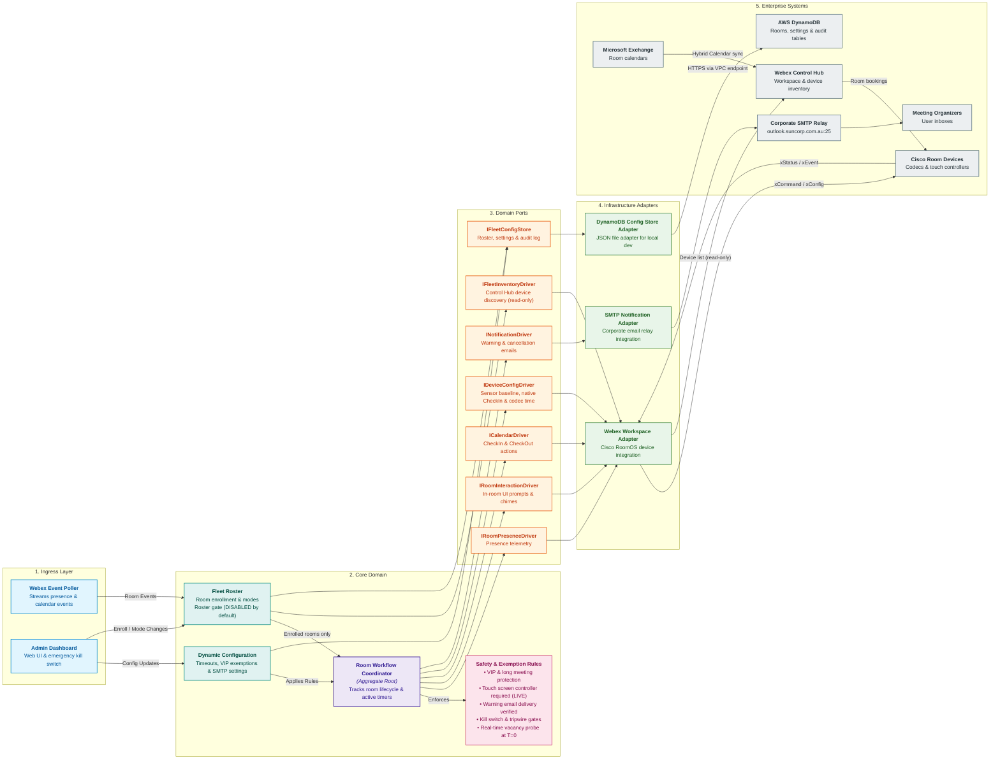

# Service Domain Driven Design

## 1. Overview

This document specifies the Domain-Driven Design (DDD) model and Hexagonal (Ports and Adapters) architecture for the external Booking Auto Cancellation service.

The service manages meeting room reservation lifecycles across ~800 meeting spaces, decoupling physical presence telemetry, in-room user interactions, calendar commands, and end-user email notifications behind clean architectural seams while enforcing strict fail-closed safety invariants.

---

## 2. Domain-Driven Design Architecture Diagram

---

## 3. Detailed Component Responsibilities

### 3.1 Driving Ingress Layer & Configuration Sources

- **`LongPollingTransport`**: Outbound HTTPS 443 persistent connection to Webex Cloud integration queues. Ingests occupancy telemetry (`RoomAnalytics.RoomInUse`), calendar availability (`Bookings.Availability`), booking details, and touch controller user interactions without requiring inbound firewall pinholes, public DNS, or reverse proxies.
- **`AdminDashboardController`**: Fastify-embedded `/admin` web interface providing a 1-click fleet Emergency Kill Switch, real-time room search, and live configuration updates for timeouts, VIP lists, and SMTP relay settings.
- **`ConfigSources`**: Secrets (Webex credentials) come from AWS SSM Parameter Store (`SecureString`) or `.env.local`. All admin-controlled state (the roster, room modes, the kill switch, timings, exemptions, and SMTP settings) is loaded from and persisted to the durable fleet configuration store (DynamoDB in AWS, a JSON file on a laptop), so dashboard changes survive restarts. The `AUTOCANCEL_KILL_SWITCH` SSM/environment parameter remains as an independent, second kill-switch source, re-read every 30 seconds so the fleet can be halted without the dashboard or a restart ([ServiceLowLevelDesign.md §8](ServiceLowLevelDesign.md)).

### 3.2 Dynamic Fleet Configuration Model

- **Timing Thresholds**: `EMPTY_ROOM_TIMEOUT_MS` (default 10m), `PRE_TIMEOUT_WARNING_MS` (default 5m), `POST_TIMEOUT_GRACE_PERIOD_MS` (default 2m), `AUTOMATIC_CHECK_IN_DELAY_MS` (3s), `BOOKING_SYNC_COALESCE_DELAY_MS` (50ms), and `BOOKING_READINESS_RECOVERY_DELAYS_MS` (`[250, 500, 1000, 2000, 4000]`).
- **Room Policy Parity Settings** (same meaning and defaults as the macro `CONFIG`): `EARLY_DEPARTURE_RELEASE_ENABLED` (default `false`), `NATIVE_CHECK_IN_WINDOW_MINUTES` (default and maximum 60; RoomOS accepts only 5, 10, 15, 20, 30, or 60; must exceed the `LIVE` release horizon), and `ULTRASOUND_SENSOR_ENABLED` (default `false`; writes `PeoplePresence.Input.Ultrasound` `On`/`Off`).
- **Exemption Rules**: `LONG_MEETING_EXEMPTION_THRESHOLD_MS` (120m), `EXEMPT_ORGANIZERS` (VIP email list), and `EXEMPT_TITLE_KEYWORDS` (e.g. "Board", "Executive", "Confidential").
- **SMTP & Notification Settings**: `NOTIFICATIONS_ENABLED` (boolean), `SMTP_HOST` (`outlook.suncorp.com.au`), `SMTP_PORT` (25), `SMTP_FROM`, and `SMTP_SECURE`. No SMTP credentials are stored in fleet settings; secrets stay in SSM.
- **Safety & Rollout Modes**: `AUTOCANCEL_KILL_SWITCH`, fleet anomaly spike threshold (>30 releases / 5 min), and per-room operational mode (`DISABLED`, `MONITOR_ONLY`, `DRY_RUN`, `LIVE`).
- **Validation**: every settings write is validated before it is persisted, and changed timings apply only to workflows started afterwards ([ServiceLowLevelDesign.md §5.10](ServiceLowLevelDesign.md)).

### 3.3 Fleet Roster (Enrollment Authority)

- Owns the answer to "which rooms does this service manage, and how". Every workspace discovered in Control Hub gets a roster entry in `DISABLED` mode. A `DISABLED` room has no actor, and all of its events are discarded at the roster gate.
- Only an administrator can promote a room: `DISABLED → MONITOR_ONLY → DRY_RUN → LIVE` (or `DISABLED → DRY_RUN`). `LIVE` is reachable only from `DRY_RUN`, after a readiness report and an explicit, audited confirmation. The system may only demote a room, for example to `DISABLED` when its managed device is replaced.
- Binds each workspace to exactly one managed device. A replaced or ambiguous device is never touched until an admin re-enrolls it.
- Enforces the roster gate on both ingress events and outbound device commands.
- Details: [ServiceLowLevelDesign.md §5.7, §7.1 and §8](ServiceLowLevelDesign.md).

### 3.4 Aggregate Root: RoomActor (`RoomWorkflowCoordinator`)

- Manages an isolated in-memory Finite State Machine for each physical room across 8 lifecycle phases: `Idle`, `Quarantined`, `ActiveMeeting`, `CountdownScheduled`, `PromptPending` (`DRY_RUN` only), `PromptVisible` (`LIVE` only), `ValidatingJIT`, and `Released`.
- **Generational Identity Counters**: Increments `bookingLifecycleId` on every meeting transition, `releaseWorkflowId` on every release attempt, and `statusEventVersion` on every presence or availability event, to cleanly reject stale, out-of-order asynchronous events and slower reads.
- **CheckIn State**: `checkInConfirmedBookingId` (service CheckIn succeeded, RoomOS reported already checked in, or `BookedFromDevice`), `dryRunSimulatedCheckInBookingId` (policy selection only), and at most one automatic CheckIn attempt per lifecycle.
- **Workflow State**: Tracks the fixed warning deadline (`promptExpiresAt`), prompt ownership per target, `warningEmailSentForDeadline`, `warningEmailFailed`, the pending service CheckOut, and `promptRestorationCount`, and manages active timers (coalescing, automatic CheckIn, countdown, warning deadline, 60-second chime loop and volume restore, prompt surface refresh, readiness recovery, and midnight health check). Full model: [ServiceLowLevelDesign.md §3.1](ServiceLowLevelDesign.md).

### 3.5 Domain Policies (Business Logic)

- **`MeetingExemptionPolicy`**: Classifies meetings longer than `LONG_MEETING_EXEMPTION_THRESHOLD_MS` or matching `EXEMPT_ORGANIZERS` / `EXEMPT_TITLE_KEYWORDS` as exempt. In `LIVE`, serializes commands to set `Bookings.CheckIn.Enabled: False` per device via a FIFO queue to protect exempt meetings from native RoomOS auto-release ([ServiceLowLevelDesign.md §5.6](ServiceLowLevelDesign.md)).
- **`StartupQuarantinePolicy`**: Quarantines meetings already underway when a room actor is created: service start or restart, a reappearing device, or promotion into `DRY_RUN`/`LIVE` (`AwaitingStartupCheckIn`); a `LIVE → DRY_RUN` demotion does the same. The quarantine lasts until the meeting ends; no event lifts it, because `Bookings.CheckedIn` is not delivered to Workspace Integrations ([ServiceLowLevelDesign.md §5.9](ServiceLowLevelDesign.md)).
- **`WarningNotificationPolicy`**: States the real time remaining to the fixed warning deadline (`promptExpiresAt`, including grace in `LIVE`; never hardcoded), formats the release time in the codec's local clock timezone, and sends one warning email per warning deadline (a dismissal restore sends none). A failed or impossible warning email sets `warningEmailFailed`, which blocks automatic release for the rest of the lifecycle while the prompt stays visible.
- **`FleetAnomalyTripwire`**: Monitors fleet-wide `LIVE` cancellation frequency (`DRY_RUN` simulated releases do not count); automatically trips if cancellations exceed 30 within any sliding 5-minute window. Like the kill switch, a tripped tripwire stops all automation: it cancels active workflows and clears prompts, starts no countdown, prompt, warning email, or automatic CheckIn, blocks every CheckOut including a user-confirmed one, and makes no native CheckIn write on activation or reset. It stays tripped across restarts until an admin resets it ([ServiceLowLevelDesign.md §5.8](ServiceLowLevelDesign.md)).

### 3.6 Safety Invariant Guards (Mandatory Fail-Closed Gates)

The release-time gates below (1, 2, and 4) must all evaluate to **Clear** before any automatic room release command may proceed; gate 3 decides whether a countdown may start at all. A user-confirmed Check Out does not need the vacancy, actionable-surface, or email gates, but still requires the fleet gates (gate 4) to be clear and a fresh booking snapshot with an unchanged booking ID. The ordered checklist is in [ServiceLowLevelDesign.md §5.5](ServiceLowLevelDesign.md):

1. **`ActionableSurfaceGuard`** (`LIVE` only): Refreshes the prompt surfaces on demand (controller topology cannot be subscribed to) and requires that a connected touch panel (`TouchPanel`, `Role: Controller`) or a certified interactive display (`Desk Pro`) still owns the displayed prompt. Strictly filters out outside `RoomScheduler` panels. An unreadable inventory invalidates controller ownership. `DRY_RUN` displays nothing and skips this gate.
2. **`WarningEmailGuard`**: While `NOTIFICATIONS_ENABLED = true`, verifies that the warning email covered the current warning deadline and that `warningEmailFailed` is not set (in `DRY_RUN`, the `[DRY RUN - WOULD_SEND_EMAIL]` entry counts; a missing organizer email still blocks). If delivery failed, the service **fails closed and preserves the booking**. With `NOTIFICATIONS_ENABLED = false`, this gate does not block.
3. **`MinimumRemainingTimeGuard`** (countdown start only): A countdown starts only if `timeRemaining` is strictly greater than the release horizon (`EMPTY_ROOM_TIMEOUT_MS + POST_TIMEOUT_GRACE_PERIOD_MS`, e.g. 12 minutes, in `LIVE`; `EMPTY_ROOM_TIMEOUT_MS` in `DRY_RUN`), allowing concluding meetings to end naturally. It is not re-checked at release time.
4. **`FleetGates`**: The kill switch is off, the tripwire is not tripped, and the room's mode is `LIVE` or `DRY_RUN`. Evaluated before every booking-changing action (automatic CheckIn, countdown start, warning, and every CheckOut).
5. **`SynchronousJitProbeGuard`**: Directly queries physical presence, booking availability, and fresh booking details at $T=0$, re-evaluates VIP/keyword exemptions, and runs gates 1, 2, and 4. If the space is occupied, sensor state is unknown, the booking changed or reclassifies as long or unclassifiable, or any gate is closed, the release is aborted and the booking preserved.

### 3.7 Outbound Domain Ports (Hexagonal Seams)

- **`IRoomPresenceDriver`**: Queries instantaneous occupancy and streams presence transitions.
- **`IRoomInteractionDriver`**: Refreshes the prompt surfaces on demand (`refreshPromptSurfaces`), displays the warning or confirmation prompt (`displayPrompt`) on the controller and OSD, restores only a dismissed target (`restoreDismissedPrompt`), clears prompts by kind (`clearPrompts`), plays one audio alert at volume 70 (`playAudioAlert`; the coordinator owns the 4-second hold and 60-second repeat), restores volume, and streams prompt responses and dismissals.
- **`ICalendarDriver`**: Queries booking availability, booking details by ID, and the current booking when the ID is missing (`getCurrentBooking`); executes `checkIn` (returning `CheckedIn`, `AlreadyCheckedIn`, or `Failed`) and `checkOut` with reason `NoShow`, `EarlyDeparture`, or `UserConfirmed`. It has no CheckIn event subscription.
- **`IDeviceConfigDriver`**: Enforces the baseline presence configuration and the native CheckIn window, reads the native CheckIn baseline (`Enabled` and `WindowDuration`), serializes native CheckIn toggles per device, and reads codec time.
- **`INotificationDriver`**: Dispatches warning alerts and differentiated cancellation receipts (No-Show vs Early Departure).
- **`IFleetInventoryDriver`**: Lists workspaces and devices visible in Control Hub. Read-only; never issues device xAPI calls.
- **`IFleetConfigStore`**: Durably loads and conditionally writes the roster and fleet settings, and appends to the audit log.
- Driving port **`IEventIngressTransport`**: delivers notifications and reports long-poll connectivity changes, which trigger a full revalidation of every actor.
- Exact signatures: [ServiceLowLevelDesign.md §2.2](ServiceLowLevelDesign.md).

### 3.8 Driven Infrastructure Adapters

- **`WebexWorkspaceAdapter`**: Implements the presence, interaction, calendar, config, and inventory driver contracts against Cisco RoomOS endpoints and Control Hub via the Webex SDK. It refuses commands and configuration writes to devices the roster gate does not allow (and every write to a `MONITOR_ONLY` device except mode-exit clean-up), queues commands per device, and honours `Retry-After` on HTTP `429`. Calendar data reaches the devices from Microsoft Exchange through Control Hub Hybrid Calendar; the adapter never calls Exchange directly.
- **`SmtpNotificationAdapter`**: Connects to `outlook.suncorp.com.au:25` as an unauthenticated direct relay to deliver responsive multipart HTML and plain-text emails to meeting organizers.
- **`DynamoFleetConfigStore`**: Implements `IFleetConfigStore` against three DynamoDB tables (rooms, settings, append-only audit) using conditional writes. `JsonFileFleetConfigStore` implements the same port on a laptop.
