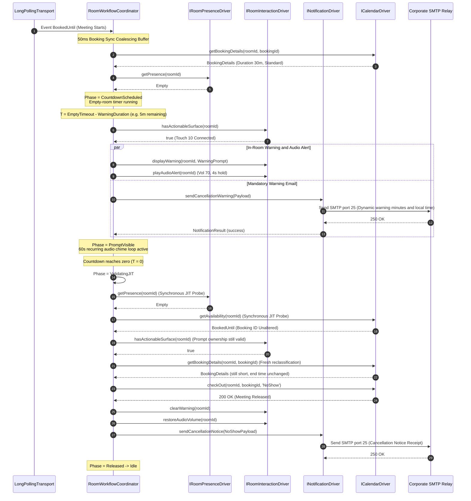
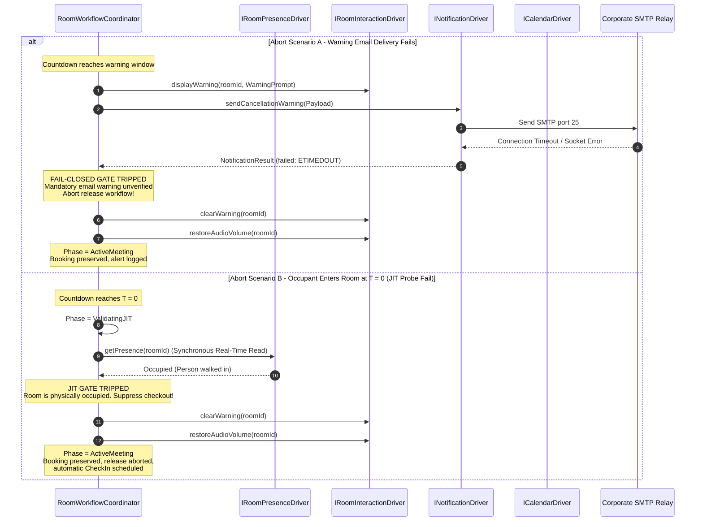

# Booking Auto Cancellation Service - Low-Level Design (LLD)

## 1. Document Purpose and Architectural Conformance

This document specifies the concrete Low-Level Design (LLD) for the centralized Booking Auto Cancellation external service.

It defines the runtime data structures, class interfaces, type signatures, finite state machine transition matrices, concurrency queues, and execution sequence diagrams required to implement the system specified in [ServiceHighLevelDesign.md](ServiceHighLevelDesign.md), [ServiceMasterSpec.md](ServiceMasterSpec.md), and [ServiceDomainDrivenDesign.md](ServiceDomainDrivenDesign.md).

**Behavioral authority:** every room-level behavior (presence handling, prompts, user responses, CheckIn, release validation, CheckOut, recovery) must match the validated codec-native macro as specified in [BookingAutoCancellationSpec.md](../../codec-native/docs/BookingAutoCancellationSpec.md). Where this document and that specification disagree, the codec-native specification governs and this document must be corrected. Service-only capabilities (email notifications, VIP/keyword exemptions, rollout modes, kill switch, tripwire, dashboard) may add conditions that preserve a booking but must never permit a release the macro would block.

---

## 2. Domain Types & Outbound Port Contracts

### 2.1 Core Domain Enums & Value Types

```typescript
export type RoomPresenceState = 'Occupied' | 'Empty' | 'Unknown';

export type RoomLifecyclePhase =
  | 'Idle'
  | 'Quarantined'
  | 'ActiveMeeting'
  | 'CountdownScheduled'
  | 'PromptVisible'
  | 'ValidatingJIT'
  | 'Released';

// DISABLED is the default for every room. A DISABLED room has no actor and all
// of its events are discarded. See §5.7 for the promotion path.
export type OperatingMode = 'DISABLED' | 'MONITOR_ONLY' | 'DRY_RUN' | 'LIVE';

export type ExemptionClassification =
  | 'Eligible'
  | 'LongMeeting'
  | 'VipOrganizer'
  | 'TitleKeyword'
  | 'Unclassifiable';

// Release policies that may send a cancellation notice email.
export type CancellationReason = 'NoShow' | 'EarlyDeparture';

// Every reason a CheckOut may be issued. A user-confirmed CheckOut sends no
// cancellation notice (the user released the room deliberately).
export type CheckOutReason = CancellationReason | 'UserConfirmed';

export type AutocancellationStatus = 'Allowed' | 'Blocked';

// Mirrors the codec-native block reasons; the last four are service-only.
export type AutocancellationBlockReason =
  | 'NoCurrentBooking'
  | 'VerifyingMeetingLength'
  | 'AwaitingStartupCheckIn'
  | 'LongMeeting'
  | 'InvalidLongMeetingExemptionConfiguration'
  | 'RequiredConfigurationsUnavailable'
  | 'RoomUseStatusUnavailable'
  | 'CouldNotVerifyCurrentBooking'
  | 'NativeCheckInSettingUnavailable'
  | 'CodecTimeUnavailable'
  | 'CheckOutFailed'
  | 'ExemptOrganizerOrTitle'
  | 'WarningEmailFailed'
  | 'KillSwitchActive'
  | 'TripwireActive';

export interface BookingDetails {
  readonly id: string;
  readonly title: string;
  readonly organizerEmail: string;
  readonly organizerName: string;
  readonly startTime: Date;
  readonly endTime: Date;
  readonly isBookedFromDevice: boolean;
}

export interface RoomAvailabilitySnapshot {
  readonly status: 'Free' | 'FreeUntil' | 'BookedUntil';
  readonly timeStamp: Date;
  readonly until?: Date;
}
```

### 2.2 Hexagonal Outbound Ports (Driver Contracts)

```typescript
// --- 1. PRESENCE TELEMETRY PORT ---
export interface PresenceChangeEvent {
  readonly roomId: string;
  readonly presence: RoomPresenceState;
  readonly timestamp: Date;
}

export interface IRoomPresenceDriver {
  getPresence(roomId: string): Promise<RoomPresenceState>;
  onPresenceChange(handler: (event: PresenceChangeEvent) => void): void;
}

// --- 2. IN-ROOM INTERACTION PORT ---
export interface WarningPromptRequest {
  readonly title: string;
  readonly text: string;
  readonly durationSeconds: number;
  readonly option1Text: string; // 'Keep Booking'
  readonly option2Text: string; // 'Check Out'
}

export interface ConfirmationPromptRequest {
  readonly title: string;
  readonly text: string;
  readonly durationSeconds: number;
  readonly confirmOptionText: string; // 'Check out'
  readonly cancelOptionText: string;  // 'Cancel'
}

export interface PromptDisplayResult {
  readonly displayedOnController: boolean;
  readonly displayedOnOsd: boolean;
}

export interface PromptResponseEvent {
  readonly roomId: string;
  readonly promptId: string;
  readonly optionId: '1' | '2';
}

export interface PromptClearedEvent {
  readonly roomId: string;
  readonly promptId: string;
}

export interface IRoomInteractionDriver {
  hasActionableSurface(roomId: string): Promise<boolean>;
  displayWarning(roomId: string, prompt: WarningPromptRequest): Promise<PromptDisplayResult>;
  displayConfirmation(roomId: string, prompt: ConfirmationPromptRequest): Promise<PromptDisplayResult>;
  clearWarning(roomId: string): Promise<void>;
  restoreDismissedPrompt(roomId: string, prompt: WarningPromptRequest): Promise<void>;
  playAudioAlert(roomId: string): Promise<void>;
  restoreAudioVolume(roomId: string): Promise<void>;
  onPromptResponse(handler: (event: PromptResponseEvent) => void): void;
  onPromptCleared(handler: (event: PromptClearedEvent) => void): void;
}

// --- 3. CALENDAR OPERATIONS PORT ---
export interface CheckedInEvent {
  readonly roomId: string;
  readonly bookingId: string;
  readonly timestamp: Date;
}

export interface ICalendarDriver {
  getAvailability(roomId: string): Promise<RoomAvailabilitySnapshot>;
  getBookingDetails(roomId: string, bookingId: string): Promise<BookingDetails | null>;
  checkIn(roomId: string, bookingId: string, trackingData?: string): Promise<void>;
  checkOut(roomId: string, bookingId: string, reason: CheckOutReason): Promise<void>;
  onCheckedIn(handler: (event: CheckedInEvent) => void): void;
}

// --- 4. DEVICE CONFIGURATION PORT ---
export interface IDeviceConfigDriver {
  enforceBaselinePresenceConfig(roomId: string): Promise<boolean>;
  enforceNativeCheckInWindow(roomId: string, windowMinutes: number): Promise<boolean>;
  setNativeCheckInEnabled(roomId: string, enabled: boolean): Promise<boolean>;
}

// --- 5. END-USER NOTIFICATION PORT ---
export interface CancellationWarningPayload {
  readonly roomId: string;
  readonly roomName: string;
  readonly organizerEmail: string;
  readonly organizerName: string;
  readonly meetingTitle: string;
  readonly warningMinutes: number; // Dynamically computed from PRE_TIMEOUT_WARNING_MS
  readonly scheduledReleaseLocalTime: string; // Formatted in codec-local timezone
}

export interface CancellationNoticePayload {
  readonly roomId: string;
  readonly roomName: string;
  readonly organizerEmail: string;
  readonly organizerName: string;
  readonly meetingTitle: string;
  readonly releaseTime: Date;
  readonly reason: CancellationReason; // 'NoShow' | 'EarlyDeparture'
}

export interface NotificationResult {
  readonly success: boolean;
  readonly messageId?: string;
  readonly error?: string;
}

export interface INotificationDriver {
  sendCancellationWarning(payload: CancellationWarningPayload): Promise<NotificationResult>;
  sendCancellationNotice(payload: CancellationNoticePayload): Promise<NotificationResult>;
}

// --- 6. DRIVING INGRESS TRANSPORT PORT ---
export interface IEventIngressTransport {
  start(): Promise<void>;
  stop(): Promise<void>;
  onNotification(handler: (payload: unknown) => void): void;
}

// --- 7. FLEET INVENTORY PORT (read-only Control Hub discovery) ---
export interface InventoryDevice {
  readonly deviceId: string;
  readonly workspaceId: string;
  readonly workspaceName: string;
  readonly product: string; // e.g. 'Cisco Room Bar', 'Cisco Desk Pro'
  readonly connectionStatus: 'connected' | 'disconnected' | 'unknown';
  readonly isBookingCapable: boolean; // false for RoomScheduler Navigators and peripherals
}

export interface IFleetInventoryDriver {
  // Lists devices visible to the integration. Never issues device xAPI calls.
  listDevices(): Promise<InventoryDevice[]>;
}

// --- 8. FLEET CONFIGURATION STORE PORT (durable admin-controlled state) ---
export type InventoryStatus = 'Present' | 'Missing' | 'DeviceMismatch' | 'AmbiguousWorkspace';

export interface RoomRosterEntry {
  readonly workspaceId: string; // Partition key
  readonly deviceId: string | null; // The single managed device; null until an admin selects one (AmbiguousWorkspace)
  readonly displayName: string;
  readonly mode: OperatingMode; // Default DISABLED
  readonly inventoryStatus: InventoryStatus;
  readonly nativeCheckInBaseline: 'True' | 'False' | null; // Captured before the first device write
  readonly cleanupIncomplete: boolean;
  readonly firstDiscoveredAt: string; // ISO timestamp
  readonly modeChangedAt: string;
  readonly modeChangedBy: string; // Admin identity, or 'system' for discovery
  readonly version: number; // Optimistic concurrency counter
}

export interface FleetSettings {
  readonly killSwitchActive: boolean;
  readonly tripwireTrippedAt: string | null; // Stays tripped across restarts until an admin resets it
  readonly emptyRoomTimeoutMs: number;
  readonly preTimeoutWarningMs: number;
  readonly postTimeoutGracePeriodMs: number;
  readonly longMeetingExemptionThresholdMs: number;
  readonly earlyDepartureReleaseEnabled: boolean;
  readonly exemptOrganizers: readonly string[];
  readonly exemptTitleKeywords: readonly string[];
  readonly notificationsEnabled: boolean;
  readonly smtp: { readonly host: string; readonly port: number; readonly from: string; readonly secure: boolean };
  readonly version: number;
}

export interface AuditRecord {
  readonly entityId: string; // workspaceId, or 'SETTINGS'
  readonly at: string; // ISO timestamp
  readonly actor: string; // 'admin' (shared dashboard login, interim) or 'system'; per-user identity after SSO
  readonly action: string; // e.g. 'ModeChanged', 'KillSwitchActivated', 'RoomDiscovered'
  readonly before: unknown;
  readonly after: unknown;
}

export interface IFleetConfigStore {
  loadRoster(): Promise<RoomRosterEntry[]>;
  loadSettings(): Promise<FleetSettings>;
  // Conditional writes: reject with a ConflictError when expectedVersion is stale.
  putRosterEntry(entry: RoomRosterEntry, expectedVersion: number | null): Promise<RoomRosterEntry>;
  putSettings(settings: FleetSettings, expectedVersion: number): Promise<FleetSettings>;
  appendAudit(record: AuditRecord): Promise<void>;
}
```

---

## 3. Core Room State Machine & Workflow Coordinator

Each managed room is encapsulated by a `RoomWorkflowCoordinator` (RoomActor) executing as an in-memory stateful actor.

### 3.1 Actor Internal State Model

```typescript
export interface RoomActorState {
  readonly roomId: string;
  roomName: string;
  operatingMode: OperatingMode;
  phase: RoomLifecyclePhase;

  // Generational Identity Counters (Race Condition Guards)
  bookingLifecycleId: number;
  releaseWorkflowId: number;
  statusEventVersion: number; // Incremented on every presence/availability event

  // Active Booking Metadata
  currentBooking: BookingDetails | null;
  exemptionStatus: ExemptionClassification;
  isAdHocBookedFromDevice: boolean;

  // Identity-bound policy decision (bound to booking ID + end time)
  autocancellationStatus: AutocancellationStatus;
  blockReason: AutocancellationBlockReason | null;
  desiredNativeCheckInEnabled: boolean | null; // null = no write (VerifyingMeetingLength)
  nativeCheckInSettingApplied: boolean;

  // CheckIn State (scoped to the booking lifecycle)
  roomOsCheckedInBookingId: string | null; // Set only by a matching Bookings.CheckedIn event
  pendingRoomOsCheckedInBookingId: string | null; // Event received before booking reconciliation
  dryRunSimulatedCheckInBookingId: string | null; // DRY_RUN only; never clears quarantine
  hasAttemptedAutomaticCheckIn: boolean; // At most one automatic CheckIn per lifecycle

  // Release Workflow State
  releasePolicy: CancellationReason | null; // 'NoShow' | 'EarlyDeparture'
  promptExpiresAt: Date | null; // Fixed once per warning; never extended by refresh or restoration
  controllerPromptDisplayed: boolean;
  osdPromptDisplayed: boolean;
  hasUserSelectedKeepBooking: boolean; // Selects REPEATED prompt text
  isAwaitingCheckOutConfirmation: boolean;
  isCheckOutInProgress: boolean;
  pendingServiceCheckOutBookingId: string | null; // Distinguishes own CheckOut from external release

  // Notification State
  warningEmailDispatched: boolean;
  promptRestorationCount: number;

  // Active Timers
  coalesceTimer: NodeJS.Timeout | null;
  automaticCheckInTimer: NodeJS.Timeout | null;
  countdownTimer: NodeJS.Timeout | null;
  warningPromptTimer: NodeJS.Timeout | null;
  chimeIntervalTimer: NodeJS.Timeout | null;
  volumeRestoreTimer: NodeJS.Timeout | null;
  readinessRecoveryTimer: NodeJS.Timeout | null;
  midnightHealthCheckTimer: NodeJS.Timeout | null;

  // Hardware Metadata
  codecTimezoneOffsetMinutes: number | null;
  hasActionableSurfaceCache: boolean | null;
}
```

### 3.2 Finite State Machine (FSM) Transition Matrix

The release horizon below is `EMPTY_ROOM_TIMEOUT_MS + POST_TIMEOUT_GRACE_PERIOD_MS` in `LIVE` mode and `EMPTY_ROOM_TIMEOUT_MS` in `DRY_RUN` mode. A countdown may start only when `timeRemaining` is strictly greater than the horizon. The warning deadline is fixed at prompt display to `PRE_TIMEOUT_WARNING_MS + POST_TIMEOUT_GRACE_PERIOD_MS` (`LIVE`) or `PRE_TIMEOUT_WARNING_MS` (`DRY_RUN`). It is never extended by prompt refresh, controller reconnection, dismissal restoration, or the confirmation guard.

| Current Phase | Incoming Event | Guard Condition | Next Phase | Executed Side Effects |
| :--- | :--- | :--- | :--- | :--- |
| **Idle** | `BookedUntil` received | Booking already active when the service started (regardless of presence) | **Quarantined** | Status `Blocked / AwaitingStartupCheckIn`. `setNativeCheckInEnabled(false)`. No automatic CheckIn, countdown, or prompt. |
| **Idle** | `BookedUntil` received | Booking first observed after startup; classification pending | **Idle** | Start 50ms coalescing buffer. Status `Blocked / VerifyingMeetingLength` (no native CheckIn write). Classify via `getBookingDetails`. |
| **Idle** | Classification complete | Long, unclassifiable, VIP/keyword exempt, or snapshot invalid | **ActiveMeeting** (blocked) | Status `Blocked` with reason. `setNativeCheckInEnabled(false)`. No automatic CheckIn, countdown, prompt, or CheckOut for this lifecycle. |
| **Idle** | Classification complete | Eligible; room occupied | **ActiveMeeting** | Status `Allowed`. `setNativeCheckInEnabled(true)`. Schedule one automatic CheckIn after `AUTOMATIC_CHECK_IN_DELAY_MS` unless `BookedFromDevice` or a matching `CheckedIn` was observed. |
| **Idle** | Classification complete | Eligible; room empty; `timeRemaining > horizon` | **CountdownScheduled** | Status `Allowed`. `setNativeCheckInEnabled(true)`. New `releaseWorkflowId`. No-Show countdown of `EMPTY_ROOM_TIMEOUT_MS - PRE_TIMEOUT_WARNING_MS`. |
| **Idle** | Classification complete | Eligible; room empty; `timeRemaining <= horizon` | **ActiveMeeting** | Log skip (`Ns remaining; requires >Ms`). Booking expires naturally. |
| **Quarantined** | `CheckedIn` received | Event `Id` matches current booking ID | **ActiveMeeting** | Status `Allowed`. `setNativeCheckInEnabled(true)`. If room empty and `EARLY_DEPARTURE_RELEASE_ENABLED`, start Early Departure countdown; otherwise no release workflow. |
| **Quarantined** | Any presence event | In quarantine | **Quarantined** | **Suppressed.** No CheckIn, countdown, prompt, or CheckOut. |
| **ActiveMeeting** | `PresenceChanged(Empty)` | Allowed; no CheckIn confirmation | **CountdownScheduled** | Cancel pending automatic CheckIn. Start No-Show countdown when `timeRemaining > horizon`. |
| **ActiveMeeting** | `PresenceChanged(Empty)` | Allowed; CheckIn confirmed; `EARLY_DEPARTURE_RELEASE_ENABLED` | **CountdownScheduled** | Start Early Departure countdown when `timeRemaining > horizon`. |
| **ActiveMeeting** | `PresenceChanged(Empty)` | CheckIn confirmed; Early Departure disabled | **ActiveMeeting** | Log only. No release workflow. |
| **ActiveMeeting** | `PresenceChanged(Occupied)` | Allowed | **ActiveMeeting** | Schedule automatic CheckIn if not yet attempted this lifecycle. |
| **CountdownScheduled** | `PresenceChanged(Occupied)` | Any | **ActiveMeeting** | Cancel countdown, invalidate `releaseWorkflowId`, schedule automatic CheckIn. |
| **CountdownScheduled** / **PromptVisible** | Matching `CheckedIn` | Active policy is No-Show | **ActiveMeeting** | Cancel No-Show workflow (clear prompts). If room empty and Early Departure enabled, start a fresh Early Departure countdown. Duplicate `CheckedIn` events never restart or extend an active Early Departure workflow. |
| **CountdownScheduled** | Countdown timer fires | Workflow ID current | **PromptVisible** | Fix the warning deadline. Display warning on controller and OSD (`INITIAL`, or `REPEATED` after a prior Keep Booking). `playAudioAlert()` and start 60s chime loop. `sendCancellationWarning()` (single email per lifecycle). If no actionable surface accepted the prompt, log it and keep the deadline so a reconnecting controller receives the remaining time; expiry then preserves the booking. |
| **PromptVisible** | `PromptResponse` option 1 (Keep Booking) | Response matches an owned, visible actionable prompt | **ActiveMeeting** | Set `hasUserSelectedKeepBooking`. `clearWarning()`, stop chime, restore volume, invalidate workflow. Re-read presence: `Empty` starts a fresh countdown (later warning uses `REPEATED` text); `Occupied` schedules automatic CheckIn; `Unknown` or failure suspends autocancellation. |
| **PromptVisible** | `PromptResponse` option 2 (Check Out) | Owned warning prompt | **PromptVisible** (confirmation guard) | Set `isAwaitingCheckOutConfirmation`. Clear only the warning prompts, then `displayConfirmation()` for the remaining deadline. |
| **PromptVisible** (guard) | Confirmation option 2 (Check out) | Owned confirmation prompt | **Released** | Re-read booking snapshot (`BookedUntil`, same booking ID); then `checkOut(roomId, bookingId, 'UserConfirmed')`. No cancellation notice email. Failure: `Blocked / CheckOutFailed`. |
| **PromptVisible** (guard) | Confirmation option 1 (Cancel) | Owned confirmation prompt | **ActiveMeeting** | Same as Keep Booking. |
| **PromptVisible** | `PromptCleared`, or response without a recognized option | Dismissed target is owned; no CheckOut in progress | **PromptVisible** | `restoreDismissedPrompt()` for that target only, with the remaining duration. Deadline unchanged. No duplicate warning email. |
| **PromptVisible** | `PresenceChanged(Occupied)` | Prompt visible | **PromptVisible** | **Retain the prompt** so occupants can read and act on it. Automatic CheckIn is deferred until Keep Booking or expiry. |
| **PromptVisible** | Stale or unmatched `PromptResponse` | No owned prompt matches | **(unchanged)** | Log `ignored`. No workflow change. |
| **PromptVisible** | Deadline reached | Unconfirmed confirmation guard | **ActiveMeeting** / **PromptVisible** | Abort (`unconfirmed_user_checkout_guard`), clear prompts, preserve booking. Re-read presence: `Empty` and still eligible restores the original warning with a full new deadline (no new pre-warning countdown); otherwise preserve without a warning. |
| **PromptVisible** | Deadline reached | No confirmation guard | **ValidatingJIT** | Halt chime loop. Run the JIT verification probe (§5.5). |
| **ValidatingJIT** | Every JIT check passes | Warning email delivered (or notifications disabled) | **Released** | `checkOut(roomId, bookingId, releasePolicy)`. Mark pending service CheckOut. `clearWarning()`. Dispatch `sendCancellationNotice()` with the policy reason. |
| **ValidatingJIT** | Presence `Occupied` | Late entry | **ActiveMeeting** | Abort (`room_not_confirmed_empty`), clear prompts, preserve booking, schedule automatic CheckIn. |
| **ValidatingJIT** | Any other JIT check fails | Unknown presence, no actionable surface, booking changed, reclassified long/unclassifiable, email failed | **ActiveMeeting** | Abort, clear prompts, preserve booking. Log `ReleaseAbortedPreserved` with the validation reason. |
| **ValidatingJIT** / **Released** | `checkOut()` rejects | Same lifecycle | **ActiveMeeting** | `Blocked / CheckOutFailed` for the rest of the lifecycle. Never `Delete`. A stale failure from an older lifecycle changes nothing. |
| **Any** | `PresenceChanged(Unknown)` or presence read fails | Any | **ActiveMeeting** (blocked) | Cancel automatic CheckIn and release workflow, clear prompts, `Blocked / RoomUseStatusUnavailable` until full presence revalidation succeeds. |
| **Any** | Availability becomes `Free` / `FreeUntil` | Any | **Idle** | New lifecycle; cancel all timers; clear prompts; `setNativeCheckInEnabled(true)` (`LIVE` only). If a known booking ended before its scheduled end and was not the service's own pending CheckOut, log `[EXTERNAL_RELEASE_OBSERVED]`. A `FreeUntil` timestamp is the next booking start, never a current end. |
| **Any** | Current booking ID changes | Rollover | **Idle** (new lifecycle) | Cancel old timers and prompts, reset per-lifecycle CheckIn state (keeping a pending `CheckedIn` whose ID matches the new booking), then evaluate the new booking as first observed after startup. |
| **Any** | Booking end time changes during countdown or prompt | Fresh classification is long or unclassifiable | **ActiveMeeting** (blocked) | Clear prompts, cancel timers, invalidate workflow, `setNativeCheckInEnabled(false)`, log suspension. |
| **Released** | Availability becomes `Free` | Release completed | **Idle** | Reset room actor state to baseline. Clear all timers. |

---

## 4. Execution Sequence Diagrams

### 4.1 Sequence 1: Standard No-Show Release Workflow



---

### 4.2 Sequence 2: In-Room User Interaction ("Keep Booking" vs "Check Out")

```mermaid
sequenceDiagram
    autonumber
    participant Controller as Touch Controller
    participant Poller as LongPollingTransport
    participant Coordinator as RoomWorkflowCoordinator
    participant Presence as IRoomPresenceDriver
    participant Interaction as IRoomInteractionDriver
    participant Calendar as ICalendarDriver

    Note over Coordinator: Warning Prompt Visible on Touch Controller

    alt User Taps "Keep Booking" (Option 1) or "Cancel" on the confirmation
        Controller->>Poller: xEvent Prompt.Response (OptionId: 1)
        Poller->>Coordinator: onPromptResponse(roomId, OptionId: 1)
        Coordinator->>Interaction: clearWarning(roomId)
        Coordinator->>Interaction: restoreAudioVolume(roomId)
        Coordinator->>Presence: getPresence(roomId) (Revalidate)
        alt Presence Empty and booking still eligible
            Note over Coordinator: Phase = CountdownScheduled<br/>Fresh countdown; next warning uses REPEATED text
        else Presence Occupied
            Note over Coordinator: Phase = ActiveMeeting<br/>Schedule automatic CheckIn
        else Presence Unknown or read fails
            Note over Coordinator: Blocked / RoomUseStatusUnavailable<br/>Booking preserved
        end
    else User Taps "Check Out" (Option 2) and Confirms (Option 2)
        Controller->>Poller: xEvent Prompt.Response (OptionId: 2)
        Poller->>Coordinator: onPromptResponse(roomId, OptionId: 2)
        Coordinator->>Interaction: clearWarning(roomId) (warning prompts only)
        Coordinator->>Interaction: displayConfirmation(roomId, ConfirmPrompt) (remaining deadline)
        Controller->>Poller: xEvent Prompt.Response (OptionId: 2)
        Poller->>Coordinator: onPromptResponse(roomId, OptionId: 2)
        Coordinator->>Calendar: getAvailability(roomId) (BookedUntil, same booking ID)
        Coordinator->>Calendar: checkOut(roomId, bookingId, 'UserConfirmed')
        Calendar-->>Coordinator: 200 OK
        Coordinator->>Interaction: clearWarning(roomId)
        Coordinator->>Interaction: restoreAudioVolume(roomId)
        Note over Coordinator: Phase = Released -> Idle<br/>No cancellation notice email
    else User Dismisses a Prompt Without a Selection
        Controller->>Poller: xEvent Prompt.Cleared
        Poller->>Coordinator: onPromptCleared(roomId)
        Coordinator->>Interaction: restoreDismissedPrompt(roomId, prompt) (remaining duration)
        Note over Coordinator: Phase = PromptVisible<br/>Deadline unchanged, no duplicate email
    else Deadline Reached While Confirmation Is Unanswered
        Coordinator->>Interaction: clearWarning(roomId)
        Coordinator->>Presence: getPresence(roomId) (Revalidate)
        Note over Coordinator: Empty: restore warning with a full new deadline<br/>Otherwise: preserve booking, no warning
    end
```

---

### 4.3 Sequence 3: Fail-Closed Safety Precondition Aborts



---

## 5. Concurrency Control & Algorithmic Specifications

### 5.1 Generational Lifecycle Guard Algorithm

To eliminate asynchronous race conditions from stale xEvents arriving out of order:

1. Every time a new meeting or schedule transition occurs on a room, `actorState.bookingLifecycleId` is incremented.
2. Every time a new countdown or warning sequence begins, `actorState.releaseWorkflowId` is incremented.
3. Every asynchronous handler (prompt responses, timer callbacks, background probes) captures its originating IDs:

   ```typescript
   function handleWarningTimerExpired(capturedLifecycleId: number, capturedWorkflowId: number): void {
     if (
       capturedLifecycleId !== actorState.bookingLifecycleId ||
       capturedWorkflowId !== actorState.releaseWorkflowId
     ) {
       // Stale event from older meeting or aborted workflow; drop silently
       return;
     }
     executeJitVerificationAndRelease();
   }
   ```

### 5.2 50ms Booking Sync Coalescing Buffer

Rapid bursts of availability status (`Bookings.Availability.Status = BookedUntil`) and timestamp events are debounced using a 50ms sliding timer:

```typescript
function onAvailabilityStatusChanged(roomId: string, status: RoomAvailabilitySnapshot): void {
  const actor = registry.get(roomId);
  if (actor.coalesceTimer) {
    clearTimeout(actor.coalesceTimer);
  }
  actor.coalesceTimer = setTimeout(async () => {
    actor.coalesceTimer = null;
    await actor.synchronizeBookingDetails();
  }, 50);
}
```

### 5.3 5-Step Bounded Readiness Recovery Schedule

When the current booking is blocked by a transient reason (`RequiredConfigurationsUnavailable`, `RoomUseStatusUnavailable`, `CouldNotVerifyCurrentBooking`, `NativeCheckInSettingUnavailable`, `CodecTimeUnavailable`, or a native CheckIn write that has not yet applied), the coordinator runs one bounded recovery sequence on delays of `BOOKING_READINESS_RECOVERY_DELAYS_MS` (default `[250ms, 500ms, 1000ms, 2000ms, 4000ms]`):

- Every attempt rebuilds the full snapshot (configuration health, presence, availability, booking identity, codec time). When the booking ID is known but the end time is missing, it uses `Bookings.Get({ Id })`. When the ID is missing, it uses `Bookings.List({ ScheduleType: 'Current', Limit: 1 })`. The returned identity and ordered future schedule are validated before policy evaluation.
- The sequence is cancelled by a valid readiness result or a lifecycle change. It captures the booking lifecycle and status-event version before its first read and discards the snapshot if either changes.
- Recovery never clears `AwaitingStartupCheckIn` and never guesses missing data. Deliberate blocks (`LongMeeting`, VIP/keyword exemptions, `CheckOutFailed`) do not schedule recovery.
- Exhaustion preserves the booking (status stays `Blocked / CouldNotVerifyCurrentBooking` or the original transient reason) and waits for the next relevant room event or the midnight health check. It never becomes an unbounded polling loop.

### 5.4 Serialized FIFO Promise Queue for Hardware Configuration

Writes to `Bookings.CheckIn.Enabled` must be strictly serialized to prevent asynchronous races on the physical endpoint:

```typescript
class DeviceConfigQueue {
  private queue: Promise<void> = Promise.resolve();

  enqueue(operation: () => Promise<void>): Promise<void> {
    const next = this.queue.then(async () => {
      try {
        await operation();
      } catch (err) {
        logger.error({ err }, 'Failed serialized device config write');
      }
    });
    this.queue = next;
    return next;
  }
}
```

Each queued write rechecks the booking lifecycle and status-event version before and after the device call. A stale write returns `false` and is never treated as authoritative.

### 5.5 Just-In-Time (JIT) Release Validation Checklist

At warning-deadline expiry, every check below must pass, in order, before `checkOut()`. Any failure aborts the release, clears both prompt surfaces, preserves the booking, and logs the reason. The checks mirror the codec-native `validateReleaseBeforeCheckOut()`. Gates 9 and 10 are service-only and can only block.

1. `bookingLifecycleId` and `releaseWorkflowId` still match (`stale_release_workflow`).
2. No unconfirmed Check Out confirmation guard (`unconfirmed_user_checkout_guard`, which follows the restore rule in §3.2).
3. Presence is supported and the autocancellation status is `Allowed` (`presence_unsupported`, `autocancellation_not_ready`).
4. A fresh `getPresence()` returns `Empty` (`room_not_confirmed_empty`; `Occupied` also schedules automatic CheckIn).
5. `LIVE` only: refresh the controller inventory, and confirm that a controller or certified interactive display still owns the displayed prompt (`no_actionable_prompt_surface`). `DRY_RUN` skips this check because no prompt is displayed.
6. A fresh `getAvailability()` returns `BookedUntil` with the same booking ID and a future end time (`current_booking_snapshot_invalid`).
7. A fresh `getBookingDetails()` reclassifies the booking as eligible, with an ID and end time that still match (`current_booking_policy_invalid`).
8. `bookingLifecycleId` and `releaseWorkflowId` are rechecked after every awaited call. A valid Keep Booking received while validation is in flight invalidates the workflow.
9. Service-only gates: warning email delivered (or `NOTIFICATIONS_ENABLED=false`), kill switch off, tripwire not tripped, room mode is `LIVE` (`DRY_RUN` logs `[DRY RUN - WOULD_RELEASE]` instead).
10. VIP organizer and title keyword exemptions are re-evaluated against the fresh booking details.

### 5.6 Native CheckIn Policy Ownership

The identity-bound autocancellation status solely owns `Bookings.CheckIn.Enabled` for an active booking in `LIVE` mode:

| Status | Native write |
| :--- | :--- |
| `Allowed` | `True` |
| `Blocked / VerifyingMeetingLength` | None |
| Any other `Blocked` reason (including `AwaitingStartupCheckIn`) | `False` |
| No current booking (`Free` / `FreeUntil`) | `True` |

A failed enable while moving to `Allowed` records `Blocked / NativeCheckInSettingUnavailable`. A failed disable keeps the existing block reason and is retried by readiness recovery. In `DRY_RUN`, startup writes `False` when the baseline is enabled (failing closed if it cannot), and the service never enables native CheckIn for an observed booking. `MONITOR_ONLY` makes no native CheckIn write and no other device write. The room's own baseline stays in force (§5.7).

### 5.7 Operating Mode Transitions

Every room has exactly one mode, stored in its roster entry (§8). Mode changes arrive at runtime from the admin dashboard. Each change is persisted first (conditional write, §8.4) and then applied by the room's actor as one serialized transition. The promotion path is fixed:

```text
DISABLED ──> MONITOR_ONLY ──> DRY_RUN ──> LIVE
    └──────────────────────────> DRY_RUN
Any mode ──> DISABLED or MONITOR_ONLY (demotion is always allowed)
```

`LIVE` is reachable only from `DRY_RUN`. How long a room stays in `DRY_RUN` is the administrator's judgement; the dashboard shows the readiness report (§8.6) at promotion time, and the runtime safety gates still fail closed regardless.

| From | To | Required effects |
| :--- | :--- | :--- |
| `DISABLED` | `MONITOR_ONLY` | Create and register the room actor. Read-only from the first moment; no device writes. |
| `DISABLED` or `MONITOR_ONLY` | `DRY_RUN` | Create the actor if needed. Before the first device write, read `Bookings.CheckIn.Enabled` and store it as `nativeCheckInBaseline` in the roster entry (once, unless already recorded). Apply the dry-run presence baseline and native CheckIn writes. If a booking is in progress, set `Blocked / AwaitingStartupCheckIn` exactly as at service startup: the service has never managed this meeting, so it must not treat it as a no-show. Only a matching `Bookings.CheckedIn` event releases the quarantine. |
| `DRY_RUN` | `LIVE` | Treat any in-progress booking as quarantined (`AwaitingStartupCheckIn`). A dry-run simulated CheckIn never carries over as confirmation. Re-run the native CheckIn policy for the current status (§5.6). |
| `LIVE` | `DRY_RUN` | Cancel any active workflow and clear prompts. Apply the dry-run native CheckIn baseline (`False`). |
| `DRY_RUN` or `LIVE` | `MONITOR_ONLY` or `DISABLED` | New `releaseWorkflowId`; cancel the countdown, prompt, chime, automatic CheckIn, and recovery timers; clear both prompt surfaces and restore volume (`LIVE` only). Restore `Bookings.CheckIn.Enabled` to the recorded `nativeCheckInBaseline`, so the room returns to its pre-enrollment behavior rather than a guessed value. These clean-up writes are the last the service makes. A failed clean-up write is logged, recorded in the audit log, and surfaced on the dashboard as `CleanupIncomplete`; it is not retried in the background. |
| `MONITOR_ONLY` | `DISABLED` | No device writes are needed. |
| Any | `DISABLED` | After the clean-up above, tear down the actor (`teardown()` clears every timer) and unregister it. From then on, every event for the device is discarded at the ingress gate (§7.1). |

`MONITOR_ONLY` actors still subscribe to presence, availability, and CheckIn events to compute utilization metrics. They hold no countdown, prompt, or automatic CheckIn timers. `DISABLED` rooms have no actor at all.

---

## 6. Corporate SMTP Notification & Template Engine

### 6.1 Dynamic Duration Calculation

Warning emails calculate the remaining window directly from configuration:

$$\text{warningMinutes} = \operatorname{Math.round}\left(\frac{\text{PRE\_TIMEOUT\_WARNING\_MS}}{60\,000}\right)$$

The impended cancellation clock time is formatted using the physical room codec's local ISO timezone offset (e.g. `+10:00` for Brisbane, `+11:00` for Sydney AEDT).

### 6.2 Multipart MIME Template Specifications

#### Cancellation Warning Email (Dispatched at Countdown Warning)

- **Subject**: `[Action Required] Room Release Warning: ${roomName}`
- **HTML Body**: Clean, responsive layout detailing:
  - Meeting Title and Room Name.
  - Notice that the room is detected as vacant.
  - Statement: *"This reservation will be automatically released in **${warningMinutes} minutes** (at **${scheduledReleaseLocalTime}**) unless physical occupancy is detected or confirmed on the room controller."*
  - Bulleted instructions:
    - If you are using the room: Occupy the space or tap **Keep Booking** on the touch screen.
    - If you no longer need the room: Tap **Check Out** on the touch controller or do nothing to allow automatic release.
- **Plain-Text Alternative**: Exact text synchronization for plain-text email clients.

#### Cancellation Notice Email (Dispatched Post-Release)

Sent only after an automatic release (`NoShow` or `EarlyDeparture`). A `UserConfirmed` CheckOut sends no notice.

- **Subject**: `Room Reservation Released: ${roomName}`
- **HTML Body**:
  - Differentiated Header based on `reason`:
    - **NoShow**: *"Your reservation was released because no physical presence was detected after meeting start."*
    - **EarlyDeparture**: *"Your reservation was released early because the room was vacated prior to scheduled end time."*
  - Room name, scheduled meeting time, and release timestamp.
  - Informational note that the room has been returned to the corporate pool for colleagues to book.

---

## 7. In-Memory Fleet Registry Architecture

The service manages up to ~800 room actors in Node.js heap memory. Only rooms whose roster mode is `MONITOR_ONLY`, `DRY_RUN`, or `LIVE` and whose `inventoryStatus` is `Present` have an actor. `DISABLED` and unrostered rooms never do.

### 7.1 Roster Gate (Ingress and Command Paths)

The roster gate is a single in-memory lookup, refreshed whenever the roster changes. It is enforced at both edges of the service:

- **Ingress:** every notification from the long-poll transport is matched by `deviceId` before dispatch. The event is **discarded** when there is no roster entry, the entry is `DISABLED`, `inventoryStatus` is not `Present`, or the event's `deviceId` differs from the entry's managed `deviceId`. Discards are counted per reason (`events_discarded_total{reason}`) and are never logged per event, so a large unenrolled estate cannot flood the logs.
- **Commands and configuration writes:** the Webex adapter rejects any xCommand or xConfig write to a device that the gate does not currently allow. It also rejects every write to a `MONITOR_ONLY` device, except the one-time clean-up writes of a mode transition (§5.7). This is defence in depth: a coordinator bug cannot touch a room that was never enrolled.
- **Before the store loads:** the gate allows nothing until the roster has been loaded successfully (§8.5).

```typescript
export class RoomRegistry {
  private readonly rooms = new Map<string, RoomWorkflowCoordinator>();

  get(roomId: string): RoomWorkflowCoordinator | undefined {
    return this.rooms.get(roomId);
  }

  register(roomId: string, coordinator: RoomWorkflowCoordinator): void {
    this.rooms.set(roomId, coordinator);
  }

  unregister(roomId: string): void {
    const actor = this.rooms.get(roomId);
    if (actor) {
      actor.teardown(); // Clears all active timers
      this.rooms.delete(roomId);
    }
  }

  getAll(): RoomWorkflowCoordinator[] {
    return Array.from(this.rooms.values());
  }
}
```

- **Memory Overhead**: Each `RoomWorkflowCoordinator` instance consumes $\approx 15\text{ KB}$ of RAM. Across 800 rooms, total fleet memory is $\approx 12\text{ MB}$, well within standard Node.js heap limits.
- **Teardown Safety**: `teardown()` guarantees all active `NodeJS.Timeout` and `Interval` handles are cleared immediately to prevent memory leaks.

---

## 8. Durable Fleet Configuration Store & Room Enrollment

### 8.1 What Is Durable and What Is Not

| State | Where it lives | Why |
| :--- | :--- | :--- |
| Room actor runtime state (phase, timers, prompt ownership, generations) | In memory only | Matches the macro. A restart is made safe by startup quarantine; persisting timers would resurrect stale workflows. |
| Roster (one entry per workspace: managed device, mode, inventory status, native CheckIn baseline) | DynamoDB | Enrollment must survive restarts and must never default to automation. |
| Fleet settings (kill switch, tripped tripwire, timings, exemptions, SMTP, notifications) | DynamoDB | Dashboard changes must survive restarts. In particular, a kill switch must never silently reset. |
| Audit log of every admin and system change | DynamoDB (append-only) | Answers "who enrolled this room and when". |
| Secrets (Webex client credentials, refresh token) | AWS SSM Parameter Store `SecureString` | Unchanged. Secrets never go into DynamoDB. |
| Tripwire sliding-window counters | In memory | Only the *tripped* state must persist; the counting window may restart. |

The core domain reaches the store only through `IFleetConfigStore` (§2.2). The adapters are `DynamoFleetConfigStore` (AWS) and `JsonFileFleetConfigStore` (laptop, §8.7).

### 8.2 DynamoDB Tables

All tables use on-demand capacity, point-in-time recovery, deletion protection, and encryption at rest. They are provisioned by Terraform and reached from the private subnets through a VPC gateway endpoint, so no internet egress is needed.

| Table | Key | Items |
| :--- | :--- | :--- |
| `booking-autocancel-rooms` | PK `workspaceId` | One `RoomRosterEntry` per workspace (~800 items). |
| `booking-autocancel-settings` | PK `id` | `GLOBAL` (the `FleetSettings` item) and `INSTANCE_LEASE` (§8.5). |
| `booking-autocancel-audit` | PK `entityId`, SK `at#uuid` | Append-only `AuditRecord` items. The service IAM role may `PutItem` and `Query` this table but has no `UpdateItem` or `DeleteItem` permission. |

No meeting subject, body, organizer, or attendee data is stored. Booking data stays in memory, as in the macro.

### 8.3 Discovery and Inventory Reconciliation

The inventory sync runs at startup and with the Tier 2 sweeper (every 15 minutes). It calls `IFleetInventoryDriver.listDevices()`, which uses only the Control Hub device list and never a device xAPI call. It then reconciles the inventory against the roster. **The system may demote a room, but it never promotes one.**

| Observation | Roster effect | Room effect |
| :--- | :--- | :--- |
| New workspace with exactly one booking-capable device | Create entry: `mode = DISABLED`, `inventoryStatus = Present`, `modeChangedBy = 'system'`. Audit `RoomDiscovered`. | None. Events stay discarded. The dashboard shows it under **Discovered (not enrolled)**. |
| New workspace with several booking-capable devices | Create entry: `DISABLED`, `deviceId = null`, `inventoryStatus = AmbiguousWorkspace`. | None. Enrollment is refused until an admin selects the managed device. |
| Managed device no longer listed | `inventoryStatus = Missing`; mode unchanged. Audit `RoomMissing`. | Tear down the actor. If the same device reappears, its actor is recreated with startup semantics (in-progress meetings are quarantined). |
| Managed device gone, but a different booking-capable device is in the workspace (e.g. a codec replaced under RMA) | `inventoryStatus = DeviceMismatch`; the system demotes the mode to `DISABLED` and clears `nativeCheckInBaseline`. Audit `DeviceReplaced`. | Tear down the actor. The new device is never touched until an admin re-enrolls it from `DISABLED`. |
| Managed device listed but `disconnected` | Unchanged (the existing offline handling in HLD §7.1 applies). | Halt any countdown or prompt and preserve the booking. |

`RoomScheduler` Navigators and peripherals are never booking-capable and are never roster candidates.

`listDevices()` returns every device in the org, even when the integration is activated only for selected locations: location-limited activation restricts xCommand and xStatus calls (`403 Forbidden` outside the permitted locations), but not the device list or configuration writes. Devices outside the activated locations therefore also become `DISABLED` entries. An enrollment attempt for such a device fails its readiness probe (status reads return `403`) and is refused. Because configuration writes are not location-limited, the outbound command gate (§7.1) must cover configuration writes as well as commands.

### 8.4 Concurrency and Writes

- Every roster and settings write is a DynamoDB conditional write on `version` (`attribute_not_exists(workspaceId)` for creation). A `ConflictError` is returned to the dashboard as "changed by someone else; reload". The service never last-writer-wins.
- The order is: persist first, then audit, then apply to memory and the actor. If the persist fails, nothing is applied (with the kill-switch exception in §8.5).
- Changes made through the dashboard take effect immediately, with no restart.

### 8.5 Failure Semantics (Fail Closed)

- **Startup:** the service loads the settings and roster before it registers any actor or opens the roster gate. If the store is unreachable, it retries reads with capped backoff (1s, 2s, 5s, 10s, then every 30s; these are store reads, not device polling). Until then, every event is discarded, no device is touched, and the dashboard shows **Configuration store unavailable: automation halted**. The service never falls back to defaults or to a cached file.
- **Runtime outage:** the service keeps operating on the last-known-good roster and settings already in memory. The dashboard rejects every write, with one exception: **activating** the kill switch applies in memory immediately, is shown as `active (not persisted)`, and is retried until it is persisted. **Deactivating** the kill switch requires a successful persist.
- **Second kill-switch source:** the kill switch is active if *either* the store item *or* the `AUTOCANCEL_KILL_SWITCH` SSM/environment parameter is true. Operators can therefore halt the fleet even when the store or the dashboard is unavailable.
- **Tripwire:** when it trips, it writes `tripwireTrippedAt`. It stays tripped across restarts until an admin resets it.
- **Single active instance:** before opening the roster gate, the service acquires the `INSTANCE_LEASE` item with a conditional write (a holder ID and an expiry roughly 30s ahead, renewed every 10s). An instance that cannot acquire or renew the lease opens no gate and tears down all actors. This prevents two instances (for example, an ECS rolling deployment overlap) from driving the same rooms. The ECS service must also deploy with `minimumHealthyPercent = 0` and `maximumPercent = 100`.

### 8.6 Promotion Readiness Report

Before the `DRY_RUN → LIVE` promotion is confirmed, the dashboard shows a per-room readiness report. Promotion requires an explicit admin confirmation, which is recorded in the audit log together with the report. There is no minimum dry-run duration; that is the administrator's judgement. The report covers:

- An actionable surface is available: a connected `TouchPanel` with `Role = Controller`, or a Desk Pro.
- Presence telemetry has been observed reporting both `Occupied` and `Empty`.
- The device reports a valid codec timezone (`Time.SystemTime` with an offset).
- The required configuration writes have succeeded.
- Dry-run evidence since the room entered `DRY_RUN`: time in `DRY_RUN`, counts of `[DRY RUN - WOULD_DISPLAY_PROMPT]`, `[DRY RUN - WOULD_RELEASE]`, and `[EXTERNAL_RELEASE_OBSERVED]`, and aborted validations by reason.

The report is advisory. The runtime safety gates (§5.5) still block any unsafe release after promotion.

### 8.7 Local Development Adapter

`JsonFileFleetConfigStore` implements the same port against `service/.local/fleet-config.json` (roster and settings) and `service/.local/fleet-audit.jsonl` (audit). Both are gitignored. It applies the same version checks, so conditional-write behavior can be tested without AWS. A fresh file starts with an empty roster: discovered rooms appear as `DISABLED`, and nothing is managed until an engineer enrolls a test room. This keeps `npm run dev` free of any database dependency (user story 21).
