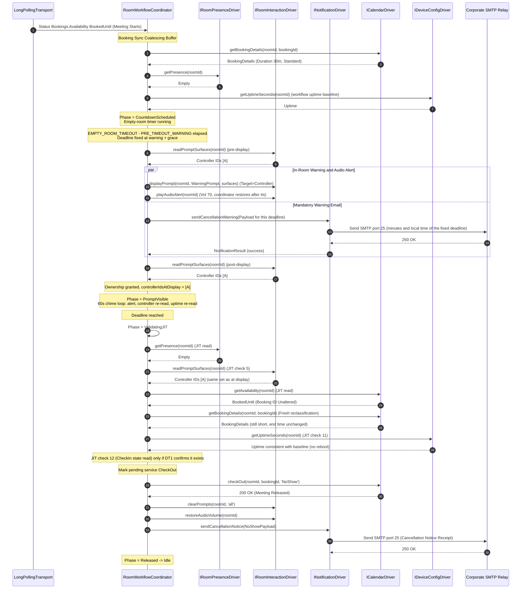
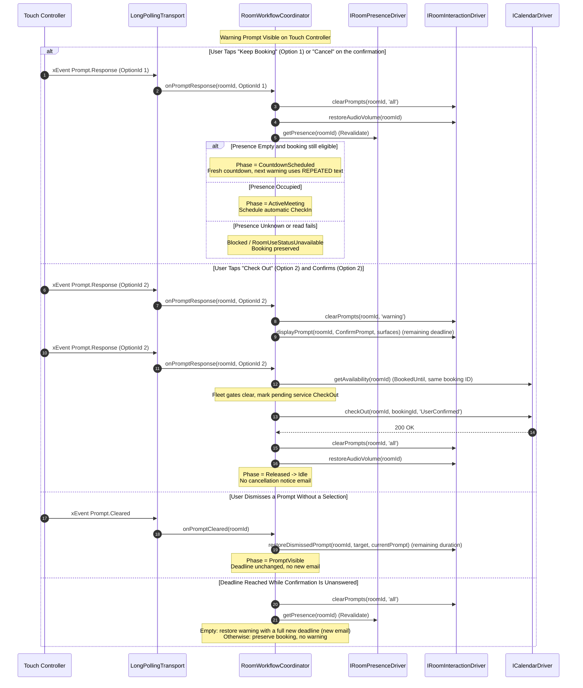
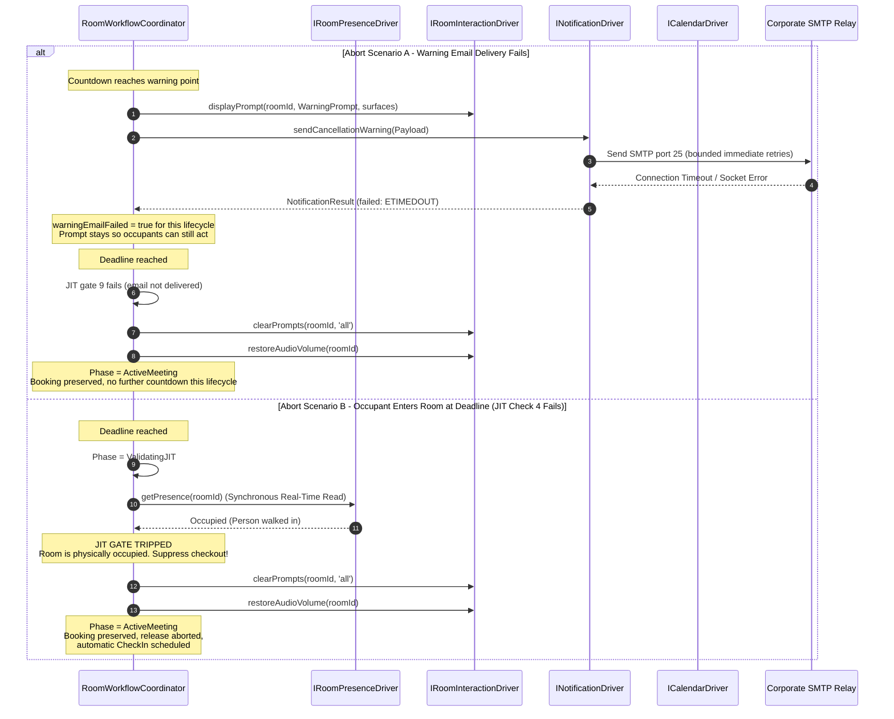

# Booking Auto Cancellation Service - Low-Level Design (LLD)

## 1. Document Purpose and Architectural Conformance

This document specifies the concrete Low-Level Design (LLD) for the centralized Booking Auto Cancellation external service.

It defines the runtime data structures, class interfaces, type signatures, finite state machine transition matrices, concurrency queues, and execution sequence diagrams required to implement the system specified in [ServiceHighLevelDesign.md](ServiceHighLevelDesign.md), [ServiceMasterSpec.md](ServiceMasterSpec.md), and [ServiceDomainDrivenDesign.md](ServiceDomainDrivenDesign.md).

**Behavioral authority:** every room-level behavior (presence handling, prompts, user responses, CheckIn, release validation, CheckOut, recovery) must match the validated codec-native macro as specified in [BookingAutoCancellationSpec.md](../../codec-native/docs/BookingAutoCancellationSpec.md). Where this document and that specification disagree, the codec-native specification governs and this document must be corrected. Service-only capabilities (email notifications, VIP/keyword exemptions, rollout modes, kill switch, tripwire, dashboard) may add conditions that preserve a booking but must never permit a release the macro would block.

---

## 2. Domain Types & Outbound Port Contracts

### 2.1 Core Domain Enums & Value Types

```typescript
export type RoomPresenceState = 'Occupied' | 'Empty' | 'Unknown';

// Service-level phases. CountdownScheduled, PromptPending and PromptVisible mirror
// the macro's RELEASE_WORKFLOW_PHASE values; Quarantined, ActiveMeeting,
// ValidatingJIT and Released are service-level groupings of macro states.
export type RoomLifecyclePhase =
  | 'Idle'
  | 'Quarantined'
  | 'ActiveMeeting'
  | 'CountdownScheduled'
  | 'PromptPending' // DRY_RUN only: simulated warning, nothing displayed
  | 'PromptVisible' // LIVE only
  | 'ValidatingJIT'
  | 'Released';

// DISABLED is the default for every room. A DISABLED room has no actor and all
// of its events are discarded. See §5.7 for the promotion path.
export type OperatingMode = 'DISABLED' | 'MONITOR_ONLY' | 'DRY_RUN' | 'LIVE';

export type ExemptionClassification =
  | 'Eligible'
  | 'LongMeeting'
  | 'VipOrganizer'
  | 'TitleKeyword'
  | 'Unclassifiable';

// Release policies that may send a cancellation notice email.
export type CancellationReason = 'NoShow' | 'EarlyDeparture';

// Every reason a CheckOut may be issued. A user-confirmed CheckOut sends no
// cancellation notice (the user released the room deliberately).
export type CheckOutReason = CancellationReason | 'UserConfirmed';

export type AutocancellationStatus = 'Allowed' | 'Blocked';

// Per-booking block reasons. The first eleven mirror the codec-native macro;
// ExemptOrganizerOrTitle is service-only. Fleet-level stops (kill switch,
// tripwire) are not booking statuses: they are gates evaluated before every
// booking-changing action (§5.8) and never trigger native CheckIn writes.
export type AutocancellationBlockReason =
  | 'NoCurrentBooking'
  | 'VerifyingMeetingLength'
  | 'AwaitingStartupCheckIn'
  | 'LongMeeting'
  | 'InvalidLongMeetingExemptionConfiguration'
  | 'RequiredConfigurationsUnavailable'
  | 'RoomUseStatusUnavailable'
  | 'CouldNotVerifyCurrentBooking'
  | 'NativeCheckInSettingUnavailable'
  | 'CodecTimeUnavailable'
  | 'CheckOutFailed'
  | 'ExemptOrganizerOrTitle';

export interface BookingDetails {
  readonly id: string;
  readonly title: string;
  readonly organizerEmail: string | null; // null when absent or unparseable (fails the email gate)
  readonly organizerName: string;
  readonly startTime: Date;
  readonly endTime: Date;
  readonly isBookedFromDevice: boolean;
}

// Mirrors the three RoomOS availability states. The timestamp meaning depends
// on the status: under BookedUntil it is the current booking end; under
// FreeUntil it is the next booking start and must never be used as a current
// end; under Free it is empty and ignored.
export type RoomAvailabilitySnapshot =
  | { readonly status: 'Free' }
  | { readonly status: 'FreeUntil'; readonly nextBookingStartTime: Date }
  | {
      readonly status: 'BookedUntil';
      readonly currentBookingId: string | null; // Bookings.Current.Id
      readonly currentBookingEndTime: Date | null; // null when missing or not in the future
    };
```

### 2.2 Hexagonal Outbound Ports (Driver Contracts)

```typescript
// --- 1. PRESENCE TELEMETRY PORT ---
export interface PresenceChangeEvent {
  readonly roomId: string;
  readonly presence: RoomPresenceState;
  readonly timestamp: Date;
}

export interface IRoomPresenceDriver {
  getPresence(roomId: string): Promise<RoomPresenceState>; // Read failure resolves to 'Unknown'
  onPresenceChange(handler: (event: PresenceChangeEvent) => void): void;
}

// --- 2. IN-ROOM INTERACTION PORT ---
export type PromptTarget = 'Controller' | 'OSD';
export type PromptKind = 'warning' | 'confirmation' | 'all';

export interface WarningPromptRequest {
  readonly kind: 'warning';
  readonly title: string;
  readonly text: string; // INITIAL or REPEATED variant
  readonly durationSeconds: number; // Remaining time to the fixed deadline
  readonly option1Text: string; // 'Keep Booking'
  readonly option2Text: string; // 'Check Out'
}

export interface ConfirmationPromptRequest {
  readonly kind: 'confirmation';
  readonly title: string;
  readonly text: string;
  readonly durationSeconds: number; // Remaining time to the same fixed deadline
  readonly confirmOptionText: string; // 'Check out' (option 2)
  readonly cancelOptionText: string; // 'Cancel' (option 1)
}

export type PromptRequest = WarningPromptRequest | ConfirmationPromptRequest;

// What the room can show right now. Controller topology cannot be subscribed to
// through a Workspace Integration, so it is read just in time at fixed workflow
// points only (§5.11): before a display, after it resolves, on each 60 s chime
// tick while a prompt is visible, and at JIT check 5. No listener, no polling timer.
export interface PromptSurfaces {
  readonly inventoryReadable: boolean; // false when the ConnectedDevice read failed or returned 403
  // Sorted IDs of Peripherals.ConnectedDevice entries with Status=Connected,
  // Type=TouchPanel, Role=Controller. RoomScheduler Navigators are excluded.
  readonly controllerIds: readonly string[];
  readonly interactiveOsd: boolean; // SystemUnit.ProductPlatform is a verified interactive OSD (Desk Pro)
}

// The coordinator, not the driver, decides ownership from the surface reads (§5.11).
export interface PromptDisplayResult {
  readonly controllerCommandAccepted: boolean; // Prompt.Display Target=Controller was accepted
  readonly displayedOnOsd: boolean;
  readonly osdActionable: boolean; // true only for an interactive OSD
}

export interface PromptResponseEvent {
  readonly roomId: string;
  readonly feedbackId: string;
  readonly optionId: string; // Normalized with String(); the xAPI schema types OptionId as an integer
  readonly origin: 'Controller' | 'OSD' | 'RoomScheduler' | 'Unknown';
}

export interface PromptClearedEvent {
  readonly roomId: string;
  readonly feedbackId: string;
}

export interface IRoomInteractionDriver {
  readPromptSurfaces(roomId: string): Promise<PromptSurfaces>; // Never rejects; a failed or 403 read sets inventoryReadable=false
  // Always sends Target=Controller (a Navigator controller is assumed), plus the
  // OSD per the platform rules, whatever the surface read found.
  displayPrompt(roomId: string, prompt: PromptRequest, surfaces: PromptSurfaces): Promise<PromptDisplayResult>;
  // Restores only the dismissed target, for the remaining duration.
  restoreDismissedPrompt(roomId: string, target: PromptTarget, prompt: PromptRequest): Promise<boolean>;
  // 'warning' clears only the warning feedback IDs (used when entering the confirmation guard).
  clearPrompts(roomId: string, kind: PromptKind): Promise<void>;
  // One alert: Audio.Volume.Set(70), Audio.Sound.Play(Announcement, Loop Off).
  // The coordinator owns the 4s hold, the volume restore, and the 60s repeat.
  playAudioAlert(roomId: string): Promise<boolean>; // false on failure; sound is optional
  restoreAudioVolume(roomId: string): Promise<void>; // Audio.Volume.SetToDefault
  onPromptResponse(handler: (event: PromptResponseEvent) => void): void;
  onPromptCleared(handler: (event: PromptClearedEvent) => void): void;
}

// --- 3. CALENDAR OPERATIONS PORT ---
export type CheckInResult =
  | { readonly outcome: 'CheckedIn' } // Command succeeded
  // Classified at the adapter by a case-insensitive substring match on 'already checked in'
  // (macro text: 'Cannot check in booking that is already checked in.'). The exact
  // text over SSH and the cloud is pending device test DT2. Any other error is 'Failed'.
  | { readonly outcome: 'AlreadyCheckedIn' }
  | { readonly outcome: 'Failed'; readonly error: string };

// PENDING device test DT1. Exists only if Bookings.Get/List or xStatus exposes a
// booking's CheckIn state. If DT1 shows it does not, this type and
// getCheckInState() are removed and the residual gap in §5.9 applies.
export type BookingCheckInState = 'CheckedIn' | 'NotCheckedIn';

export interface ICalendarDriver {
  getAvailability(roomId: string): Promise<RoomAvailabilitySnapshot | null>; // null when the read fails (never mapped to Free)
  getBookingDetails(roomId: string, bookingId: string): Promise<BookingDetails | null>; // Bookings.Get({ Id })
  getCurrentBooking(roomId: string): Promise<BookingDetails | null>; // Bookings.List({ ScheduleType: 'Current', Limit: 1 }); used only when the ID is missing
  getCheckInState(roomId: string, bookingId: string): Promise<BookingCheckInState | null>; // PENDING DT1; read-only, no side effects; null when unreadable
  checkIn(roomId: string, bookingId: string, trackingData: string): Promise<CheckInResult>;
  checkOut(roomId: string, bookingId: string, reason: CheckOutReason): Promise<void>; // Rejects on failure
  // No onCheckedIn: Bookings.CheckedIn is not delivered to Workspace Integrations (§5.9, §9).
}

// --- 4. DEVICE CONFIGURATION AND HEALTH PORT ---
export interface DeviceBootEvent {
  readonly roomId: string;
  readonly action: 'Restart' | 'Shutdown' | 'Upgrade' | 'Unknown'; // BootEvent fires BEFORE the restart (§9)
}

export interface IDeviceConfigDriver {
  // RoomAnalytics presence baseline (§5.12), batched with xapi.config.setMany where possible.
  enforceBaselinePresenceConfig(roomId: string, ultrasoundEnabled: boolean): Promise<boolean>;
  getNativeCheckInEnabled(roomId: string): Promise<'True' | 'False' | null>; // null when unreadable
  getNativeCheckInWindow(roomId: string): Promise<number | null>;
  enforceNativeCheckInWindow(roomId: string, windowMinutes: number): Promise<boolean>; // RoomOS accepts 5, 10, 15, 20, 30, 60
  setNativeCheckInEnabled(roomId: string, enabled: boolean): Promise<boolean>; // false on failure; serialized per device (§5.4)
  getCodecTime(roomId: string): Promise<string | null>; // Time.SystemTime with its offset; null when unavailable
  getUptimeSeconds(roomId: string): Promise<number | null>; // SystemUnit.Uptime (status get); null when unreadable (§5.13)
  // Early trigger only; never a safety gate. There is no "booted" event (§5.13, §9).
  onBootEvent(handler: (event: DeviceBootEvent) => void): void;
}

// --- 5. END-USER NOTIFICATION PORT ---
export interface CancellationWarningPayload {
  readonly roomId: string;
  readonly roomName: string;
  readonly organizerEmail: string;
  readonly organizerName: string;
  readonly meetingTitle: string;
  readonly warningMinutes: number; // ceil((promptExpiresAt - now) / 60000): the real time to the fixed deadline
  readonly scheduledReleaseLocalTime: string; // promptExpiresAt formatted in the codec-local timezone
}

export interface CancellationNoticePayload {
  readonly roomId: string;
  readonly roomName: string;
  readonly organizerEmail: string;
  readonly organizerName: string;
  readonly meetingTitle: string;
  readonly releaseTime: Date;
  readonly reason: CancellationReason; // 'NoShow' | 'EarlyDeparture'
}

export interface NotificationResult {
  readonly success: boolean;
  readonly messageId?: string;
  readonly error?: string;
}

export interface INotificationDriver {
  sendCancellationWarning(payload: CancellationWarningPayload): Promise<NotificationResult>;
  sendCancellationNotice(payload: CancellationNoticePayload): Promise<NotificationResult>;
}

// --- 6. DRIVING INGRESS TRANSPORT PORT ---
export interface IEventIngressTransport {
  start(): Promise<void>;
  // The Webex SDK cannot stop its long-poll loop (§9): stop() closes the
  // roster gate so no further notification is dispatched.
  stop(): Promise<void>;
  onNotification(handler: (payload: unknown) => void): void;
  onConnectivityChange(handler: (connected: boolean) => void): void; // Poll errors and recovery (§9)
}

// --- 7. FLEET INVENTORY PORT (read-only Control Hub discovery) ---
export interface InventoryDevice {
  readonly deviceId: string;
  readonly workspaceId: string;
  readonly workspaceName: string;
  readonly locationId: string | null; // Groups devices by Control Hub location on the dashboard
  readonly product: string; // e.g. 'Cisco Room Bar', 'Cisco Desk Pro'
  readonly connectionStatus: 'connected' | 'disconnected' | 'unknown'; // SDK 'connected_with_issues' maps to 'connected'; any other value to 'unknown'
  readonly isBookingCapable: boolean; // false for RoomScheduler Navigators and accessories
}

export interface IFleetInventoryDriver {
  // Lists every device in the org (location-limited activation does not limit
  // the list). Never issues device xAPI calls.
  listDevices(): Promise<InventoryDevice[]>;
}

// --- 8. FLEET CONFIGURATION STORE PORT (durable admin-controlled state) ---
export type InventoryStatus = 'Present' | 'Missing' | 'DeviceMismatch' | 'AmbiguousWorkspace';

export interface RoomRosterEntry {
  readonly workspaceId: string; // Partition key
  readonly deviceId: string | null; // The single managed device; null until an admin selects one (AmbiguousWorkspace)
  readonly displayName: string;
  readonly locationId: string | null;
  readonly mode: OperatingMode; // Default DISABLED
  readonly inventoryStatus: InventoryStatus;
  // Captured before the first device write (§5.7) and restored on demotion.
  readonly nativeCheckInBaseline: { readonly enabled: 'True' | 'False'; readonly windowMinutes: number } | null;
  readonly cleanupIncomplete: boolean;
  readonly firstDiscoveredAt: string; // ISO timestamp
  readonly modeChangedAt: string;
  readonly modeChangedBy: string; // 'admin' (shared dashboard login, interim) or 'system'
  readonly version: number; // Optimistic concurrency counter
}

export interface FleetSettings {
  readonly killSwitchActive: boolean;
  readonly tripwireTrippedAt: string | null; // Stays tripped across restarts until an admin resets it
  readonly emptyRoomTimeoutMs: number;
  readonly preTimeoutWarningMs: number;
  readonly postTimeoutGracePeriodMs: number;
  readonly longMeetingExemptionThresholdMs: number; // 0 disables the exemption
  readonly nativeCheckInWindowMinutes: number;
  readonly ultrasoundSensorEnabled: boolean;
  readonly automaticCheckInDelayMs: number;
  readonly bookingSyncCoalesceDelayMs: number;
  readonly bookingReadinessRecoveryDelaysMs: readonly number[];
  readonly earlyDepartureReleaseEnabled: boolean;
  readonly exemptOrganizers: readonly string[];
  readonly exemptTitleKeywords: readonly string[];
  readonly notificationsEnabled: boolean;
  readonly smtp: { readonly host: string; readonly port: number; readonly from: string; readonly secure: boolean }; // No credentials: secrets stay in SSM
  readonly version: number;
}

export interface AuditRecord {
  readonly entityId: string; // workspaceId, or 'SETTINGS'
  readonly at: string; // ISO timestamp
  readonly actor: string; // 'admin' (shared dashboard login, interim) or 'system'; per-user identity after SSO
  readonly action: string; // e.g. 'ModeChanged', 'KillSwitchActivated', 'RoomDiscovered'
  readonly before: unknown;
  readonly after: unknown;
}

export interface IFleetConfigStore {
  loadRoster(): Promise<RoomRosterEntry[]>;
  loadSettings(): Promise<FleetSettings>;
  // Conditional writes: reject with a ConflictError when expectedVersion is stale.
  putRosterEntry(entry: RoomRosterEntry, expectedVersion: number | null): Promise<RoomRosterEntry>;
  putSettings(settings: FleetSettings, expectedVersion: number): Promise<FleetSettings>;
  appendAudit(record: AuditRecord): Promise<void>;
}
```

---

## 3. Core Room State Machine & Workflow Coordinator

Each managed room is encapsulated by a `RoomWorkflowCoordinator` (RoomActor) executing as an in-memory stateful actor.

### 3.1 Actor Internal State Model

```typescript
export interface RoomActorState {
  readonly roomId: string;
  roomName: string;
  operatingMode: OperatingMode;
  phase: RoomLifecyclePhase;

  // Generational Identity Counters (Race Condition Guards)
  bookingLifecycleId: number;
  releaseWorkflowId: number;
  statusEventVersion: number; // Incremented on every presence/availability event

  // Active Booking Metadata
  currentBookingId: string | null;
  currentBookingEndTime: Date | null; // Only from BookedUntil; never from FreeUntil
  currentBookingStartTime: Date | null; // Cleared whenever the end time changes
  currentBooking: BookingDetails | null;
  exemptionStatus: ExemptionClassification;
  isAdHocBookedFromDevice: boolean;
  wasActiveWhenActorCreated: boolean; // Drives startup quarantine (also set by a restart after a detected reboot, §5.13)

  // Identity-bound policy decision (bound to booking ID + end time)
  autocancellationStatus: AutocancellationStatus;
  blockReason: AutocancellationBlockReason | null;
  desiredNativeCheckInEnabled: boolean | null; // null = no write (VerifyingMeetingLength)
  nativeCheckInSettingApplied: boolean;

  // CheckIn State (scoped to the booking lifecycle; see §5.9)
  checkInConfirmedBookingId: string | null; // Service CheckIn succeeded, RoomOS reported already checked in, or BookedFromDevice
  dryRunSimulatedCheckInBookingId: string | null; // DRY_RUN only; policy selection only; never clears quarantine
  hasAttemptedAutomaticCheckIn: boolean; // At most one automatic CheckIn per lifecycle

  // Release Workflow State
  releasePolicy: CancellationReason | null; // 'NoShow' | 'EarlyDeparture'
  promptExpiresAt: Date | null; // Fixed once per warning; never extended by refresh or restoration
  controllerPromptDisplayed: boolean; // Ownership: granted only by the pre- and post-display controller reads (§5.11)
  osdPromptDisplayed: boolean;
  controllerIdsAtDisplay: readonly string[] | null; // Controller-ID set captured at the warning display; JIT check 5 compares against it
  workflowStartedAt: Date | null; // When the current release workflow's countdown started
  deviceUptimeBaselineSeconds: number | null; // SystemUnit.Uptime read when the countdown started (§5.13)
  deviceReconcilePending: boolean; // Set by a BootEvent; the next device event runs full reconciliation (§5.13)
  hasUserSelectedKeepBooking: boolean; // Selects REPEATED prompt text
  isAwaitingCheckOutConfirmation: boolean;
  isCheckOutInProgress: boolean;
  pendingServiceCheckOutBookingId: string | null; // Set BEFORE every checkOut() call; distinguishes own CheckOut from external release

  // Notification State (§5.8)
  warningEmailSentForDeadline: Date | null; // promptExpiresAt the last successful (or DRY_RUN simulated) warning email covered
  warningEmailFailed: boolean; // Blocks automatic release for the rest of the lifecycle
  promptRestorationCount: number;

  // Active Timers
  coalesceTimer: NodeJS.Timeout | null;
  automaticCheckInTimer: NodeJS.Timeout | null;
  countdownTimer: NodeJS.Timeout | null;
  warningPromptTimer: NodeJS.Timeout | null;
  chimeIntervalTimer: NodeJS.Timeout | null; // 60 s tick; also drives the controller and uptime re-reads (§5.11, §5.13)
  volumeRestoreTimer: NodeJS.Timeout | null;
  readinessRecoveryTimer: NodeJS.Timeout | null;
  midnightHealthCheckTimer: NodeJS.Timeout | null; // Codec-local midnight plus this room's jitter (§5.12)

  // Hardware Metadata
  codecTimezoneOffsetMinutes: number | null;
}
```

### 3.2 Finite State Machine (FSM) Transition Matrix

**Scope by mode.** The matrix applies to `DRY_RUN` and `LIVE` actors. `MONITOR_ONLY` actors track presence and availability for utilization only and execute none of the side effects below. In `DRY_RUN`, every device-facing side effect is suppressed and replaced by its dry-run log: no prompt display, clear, restore, or audio; no CheckIn or CheckOut; no `setNativeCheckInEnabled(true)` (the dry-run baseline keeps native CheckIn `False`). Rows marked *LIVE* or *DRY_RUN* apply only in that mode.

**Timing.** The release horizon is `EMPTY_ROOM_TIMEOUT_MS + POST_TIMEOUT_GRACE_PERIOD_MS` in `LIVE` and `EMPTY_ROOM_TIMEOUT_MS` in `DRY_RUN`. A countdown may start only when `timeRemaining` is strictly greater than the horizon. The warning deadline is fixed when the warning starts: `PRE_TIMEOUT_WARNING_MS + POST_TIMEOUT_GRACE_PERIOD_MS` (`LIVE`) or `PRE_TIMEOUT_WARNING_MS` (`DRY_RUN`). It is never extended by the chime-tick controller re-read or re-display (§5.11), dismissal restoration, or the confirmation guard.

**Fleet gates.** Before every booking-changing action (automatic CheckIn, countdown start, warning, CheckOut), the coordinator evaluates the kill switch and tripwire (§5.8). When either is active, the row's action is not taken. Native CheckIn writes are also withheld; presence baseline and CheckIn window writes still run (§5.12).

**Pending DT1.** Rows that start a No-Show countdown also require, if device test DT1 shows the CheckIn state is readable, a fresh `getCheckInState()` that reports `NotCheckedIn` (§5.9). A `CheckedIn` result records CheckIn confirmation instead; an unreadable state starts no countdown.

| Current Phase | Incoming Event | Guard Condition | Next Phase | Executed Side Effects |
| :--- | :--- | :--- | :--- | :--- |
| **Idle** | `BookedUntil` received | Booking was already active when this actor was created (service start, store load, Missing device reappearing, promotion into `DRY_RUN`/`LIVE`, or restart after a detected reboot, §5.13) | **Quarantined** | Status `Blocked / AwaitingStartupCheckIn`. `setNativeCheckInEnabled(false)` (*LIVE*). No automatic CheckIn, countdown, or prompt. |
| **Idle** | `BookedUntil` received | Booking first observed after the actor was created | **Idle** | Start the coalescing buffer (`BOOKING_SYNC_COALESCE_DELAY_MS`). Status `Blocked / VerifyingMeetingLength` (no native CheckIn write). Classify via `getBookingDetails` (§5.3 when the ID or end time is missing). If `BookedFromDevice`, record CheckIn confirmation (§5.9). |
| **Idle** | Classification complete | Long, unclassifiable, VIP/keyword exempt, or snapshot invalid | **ActiveMeeting** (blocked) | Status `Blocked` with reason. `setNativeCheckInEnabled(false)` (*LIVE*). No automatic CheckIn, countdown, prompt, or CheckOut for this lifecycle. |
| **Idle** | Classification complete | Eligible; room occupied | **ActiveMeeting** | Status `Allowed`. `setNativeCheckInEnabled(true)` (*LIVE*). Schedule one automatic CheckIn after `AUTOMATIC_CHECK_IN_DELAY_MS` unless CheckIn is already confirmed (§5.9). |
| **Idle** | Classification complete | Eligible; room empty; no CheckIn confirmation; `timeRemaining > horizon` | **CountdownScheduled** | Status `Allowed`. `setNativeCheckInEnabled(true)` (*LIVE*). New `releaseWorkflowId`. Read `getUptimeSeconds()` as the workflow's uptime baseline (§5.13); unreadable starts no countdown. No-Show countdown of `EMPTY_ROOM_TIMEOUT_MS - PRE_TIMEOUT_WARNING_MS`. |
| **Idle** | Classification complete | Eligible; room empty; CheckIn confirmed (e.g. `BookedFromDevice`) | **CountdownScheduled** or **ActiveMeeting** | Status `Allowed`. If `EARLY_DEPARTURE_RELEASE_ENABLED` and `timeRemaining > horizon`, start an Early Departure countdown; otherwise no release workflow. |
| **Idle** | Classification complete | Eligible; room empty; `timeRemaining <= horizon` | **ActiveMeeting** | Log skip (`Ns remaining; requires >Ms`). Booking expires naturally. |
| **Quarantined** | Any presence event | In quarantine | **Quarantined** | Presence is recorded; no action. No CheckIn, countdown, prompt, or CheckOut. Unknown presence keeps `AwaitingStartupCheckIn` (it never replaces it with a retryable reason). |
| **Quarantined** | Meeting ends (`Free`/`FreeUntil`) or booking ID changes | — | **Idle** | Quarantine ends with the meeting. Nothing lifts it early, and a quarantined meeting is never released automatically (§5.9). |
| **ActiveMeeting** | `PresenceChanged(Empty)` | Allowed; no CheckIn confirmation | **CountdownScheduled** | Cancel pending automatic CheckIn. Start No-Show countdown when `timeRemaining > horizon`, with a fresh uptime baseline (§5.13). |
| **ActiveMeeting** | `PresenceChanged(Empty)` | Allowed; CheckIn confirmed; `EARLY_DEPARTURE_RELEASE_ENABLED` | **CountdownScheduled** | Start Early Departure countdown when `timeRemaining > horizon`, with a fresh uptime baseline (§5.13). |
| **ActiveMeeting** | `PresenceChanged(Empty)` | CheckIn confirmed; Early Departure disabled | **ActiveMeeting** | Log only. No release workflow. |
| **ActiveMeeting** | `PresenceChanged(Occupied)` | Allowed | **ActiveMeeting** | Schedule automatic CheckIn if not yet attempted this lifecycle. |
| **ActiveMeeting** | Automatic CheckIn timer fires | Revalidated: same lifecycle and booking ID, `BookedUntil`, future end time, occupied, Allowed, not confirmed | **ActiveMeeting** | *LIVE:* `checkIn(roomId, bookingId, 'BookingAutoCancellation_Automatic')`; `CheckedIn` or `AlreadyCheckedIn` records CheckIn confirmation (§5.9; treating `AlreadyCheckedIn` as confirmation is an intentional difference, §5.14); `Failed` is logged and never retried, and does not block a later No-Show. *DRY_RUN:* log `[DRY RUN - INTENT_TO_AUTOMATIC_CHECK_IN]` and `[DRY RUN - SIMULATED_CHECK_IN]`, set `dryRunSimulatedCheckInBookingId`. |
| **CountdownScheduled** | `PresenceChanged(Occupied)` | Any | **ActiveMeeting** | Cancel countdown, invalidate `releaseWorkflowId`, schedule automatic CheckIn. |
| **CountdownScheduled** | Countdown timer fires | *DRY_RUN*; workflow ID current | **PromptPending** | Log `[DRY RUN - WOULD_DISPLAY_PROMPT]` and `[DRY RUN - WOULD_SEND_EMAIL]` (the simulated email satisfies the email gate). Arm the deadline (`PRE_TIMEOUT_WARNING_MS`). No display, audio, or email. |
| **CountdownScheduled** | Countdown timer fires | *LIVE*; workflow ID current | **PromptVisible** | Fix the warning deadline. `readPromptSurfaces()`, then display the warning with `Target=Controller` (always) and on the OSD per platform rules (`INITIAL`, or `REPEATED` after a prior Keep Booking). Grant controller ownership and capture `controllerIdsAtDisplay` only if the pre-display read found a controller and a re-read after the display resolves still finds it (§5.11). `playAudioAlert()` and start the 60s chime loop (sound failure is logged and ignored). `sendCancellationWarning()` for this deadline (§5.8). If no actionable surface owns the prompt, log it and keep the deadline; expiry then preserves the booking. |
| **PromptPending** | `PresenceChanged(Occupied)` | *DRY_RUN* | **ActiveMeeting** | Cancel the simulated warning, invalidate the workflow, schedule the (simulated) automatic CheckIn. |
| **PromptPending** | Deadline reached | *DRY_RUN* | **ValidatingJIT** | Run release validation (§5.5) without the actionable-surface check. |
| **PromptVisible** | `PromptResponse` option 1 (Keep Booking) | Response `FeedbackId` matches the current workflow's visible prompt, including a re-displayed one (§5.11) | **ActiveMeeting** | Set `hasUserSelectedKeepBooking`. `clearPrompts('all')`, stop chime, restore volume, invalidate workflow. Re-read presence: `Empty` starts a fresh countdown (later warning uses `REPEATED` text); `Occupied` schedules automatic CheckIn; `Unknown` or failure suspends autocancellation. |
| **PromptVisible** | `PromptResponse` option 2 (Check Out) | Owned warning prompt | **PromptVisible** (confirmation guard) | Set `isAwaitingCheckOutConfirmation`. `clearPrompts('warning')` only, then display the confirmation prompt for the remaining deadline. |
| **PromptVisible** (guard) | Confirmation option 2 (Check out) | Owned confirmation prompt; fleet gates clear | **Released** | Set `isCheckOutInProgress`. Re-read the booking snapshot (`BookedUntil`, same booking ID). Mark pending service CheckOut, then `checkOut(roomId, bookingId, 'UserConfirmed')`. No cancellation notice email. Failure: `Blocked / CheckOutFailed`. |
| **PromptVisible** (guard) | Confirmation option 1 (Cancel) | Owned confirmation prompt | **ActiveMeeting** | Same as Keep Booking. |
| **PromptVisible** | `PromptCleared`, or a response without a recognized option | Dismissed target is owned (warning or confirmation); no CheckOut in progress | **PromptVisible** | `restoreDismissedPrompt(target, currentPrompt)` for that target only, with the remaining duration. Deadline unchanged. Chime continues. No new warning email. |
| **PromptVisible** | `PresenceChanged(Occupied)` | Prompt visible | **PromptVisible** | **Retain the prompt** so occupants can read and act on it. Automatic CheckIn is deferred until Keep Booking or expiry. |
| **PromptVisible** | Stale or unmatched `PromptResponse` | No owned prompt matches | **(unchanged)** | Log `ignored`. No workflow change. |
| **PromptVisible** | 60s chime tick | Workflow ID current | **PromptVisible** | `playAudioAlert()`. Re-read `readPromptSurfaces()`: if the controller-ID set changed or the read failed, drop controller ownership and, if this workflow captured a set at display and a controller is now present, re-display the current prompt with the remaining duration only (§5.11). Re-read `getUptimeSeconds()`; a detected reboot follows the reboot row below. The deadline never moves. |
| **PromptVisible** | Warning email fails (after bounded retries) or the organizer email is missing | Notifications enabled | **PromptVisible** | Set `warningEmailFailed` (lifecycle-scoped, never recovered automatically). Keep the prompt so occupants can still act. Automatic release is blocked at expiry; no new countdown starts for this lifecycle. |
| **PromptVisible** | Deadline reached | Unconfirmed confirmation guard | **ActiveMeeting** / **PromptVisible** | Abort (`unconfirmed_user_checkout_guard`), clear prompts, preserve booking. Re-read presence: `Empty` and still eligible restores the original warning with a full new deadline (no new pre-warning countdown; a new warning email is sent for the new deadline); otherwise preserve without a warning. |
| **PromptVisible** | Deadline reached | No confirmation guard | **ValidatingJIT** | Halt the chime loop. Run the JIT release validation (§5.5). |
| **ValidatingJIT** | Every JIT check passes | — | **Released** | *LIVE:* mark pending service CheckOut, then `checkOut(roomId, bookingId, releasePolicy)`; `clearPrompts('all')`; dispatch `sendCancellationNotice()` with the policy reason. *DRY_RUN:* log `[DRY RUN - WOULD_RELEASE]`; no command. |
| **ValidatingJIT** | Presence `Occupied` | Late entry | **ActiveMeeting** | Abort (`room_not_confirmed_empty`), clear prompts, preserve booking, schedule automatic CheckIn. |
| **ValidatingJIT** | Any other JIT check fails | See §5.5 | **ActiveMeeting** | Abort, preserve booking, log `ReleaseAbortedPreserved` with the validation reason. Prompts are cleared only for the checks listed in §5.5. |
| **ValidatingJIT** / **Released** | `checkOut()` rejects | Same lifecycle | **ActiveMeeting** | Clear the pending service CheckOut. `Blocked / CheckOutFailed` for the rest of the lifecycle. Never `Delete`. A stale failure from an older lifecycle changes nothing. |
| **ActiveMeeting** / **CountdownScheduled** / **PromptPending** / **PromptVisible** / **ValidatingJIT** | `PresenceChanged(Unknown)` or presence read fails | Booking active and not quarantined | **ActiveMeeting** (blocked) | Cancel automatic CheckIn and release workflow, clear prompts, `Blocked / RoomUseStatusUnavailable` until full presence revalidation succeeds. (`Quarantined` and `Idle` only record presence.) |
| **Any** | Availability becomes `Free` / `FreeUntil` | Any | **Idle** | New lifecycle; cancel all timers; clear prompts; `setNativeCheckInEnabled(true)` (*LIVE*). If a known booking ended before its scheduled end and was not the service's own pending CheckOut, log `[EXTERNAL_RELEASE_OBSERVED]`. A `FreeUntil` timestamp is the next booking start, never a current end. A completed release (`Released`) also returns here. |
| **Any** | Current booking ID changes | Rollover | **Idle** (new lifecycle) | Cancel old timers and prompts, reset per-lifecycle CheckIn and email state, then evaluate the new booking as first observed after the actor was created. |
| **Any** | Booking end time changes during countdown or prompt | Fresh classification is long or unclassifiable | **ActiveMeeting** (blocked) | Clear prompts, cancel timers, invalidate workflow, `setNativeCheckInEnabled(false)` (*LIVE*), log suspension. |
| **Any** | Midnight health check (codec-local midnight plus this room's jitter) | — | **(evaluated next)** | First apply the mode's configuration writes (§5.12): presence baseline and CheckIn window, `Enabled=False` in *DRY_RUN*, and the §5.6 policy in *LIVE*. Then re-verify configuration, presence, booking snapshot, and codec time. |
| **Any** | Midnight health check | Writes and validation succeed | **(unchanged)** | Keep an active valid workflow without duplicating timers; reschedule the next midnight check. |
| **Any** | Midnight health check | A write or validation fails | **ActiveMeeting** (blocked) | Cancel the workflow and prompts, preserve the booking, wait for event-driven recovery (§5.3). |
| **Any** | Readiness recovery attempt, ingress reconnect, or lease re-acquire | — | **(evaluated next)** | Same order as midnight: the mode's configuration writes first, then full revalidation (§5.3, §5.12). Failure keeps the transient block and preserves the booking. |
| **Any** | Device reboot detected: `SystemUnit.Uptime` decreased below the baseline, or is less than the workflow's age | A release workflow is active | **Quarantined** or **Idle** | Abort (`device_rebooted_during_workflow`), invalidate and cancel the workflow, clear prompts, preserve the booking. Restart the actor with startup semantics: an in-progress meeting is quarantined until it ends (`setNativeCheckInEnabled(false)` *LIVE*), then full reconciliation (§5.12, §5.13). |
| **Any** | `BootEvent` (`Restart`, `Shutdown`, `Upgrade`) | Any | **(unchanged)** or **ActiveMeeting** | Early trigger only: cancel any active workflow, clear prompts (best effort), restore volume, preserve the booking, set `deviceReconcilePending`. The next device event or read runs the uptime check and full reconciliation (§5.13). Never a safety gate. |

---

## 4. Execution Sequence Diagrams

### 4.1 Sequence 1: Standard No-Show Release Workflow (LIVE)



---

### 4.2 Sequence 2: In-Room User Interaction ("Keep Booking" vs "Check Out")



---

### 4.3 Sequence 3: Fail-Closed Safety Precondition Aborts



---

## 5. Concurrency Control & Algorithmic Specifications

### 5.1 Generational Lifecycle Guard Algorithm

To eliminate asynchronous race conditions from stale xEvents arriving out of order:

1. Every time a new meeting or schedule transition occurs on a room, `actorState.bookingLifecycleId` is incremented.
2. Every time a new countdown or warning sequence begins, `actorState.releaseWorkflowId` is incremented.
3. Every presence or availability event increments `actorState.statusEventVersion`. A booking snapshot read captures it before its first await and is discarded if it changed, so a newer event always wins over a slower read.
4. Every asynchronous handler (prompt responses, timer callbacks, device reads, command completions) captures its originating IDs:

   ```typescript
   function handleWarningTimerExpired(capturedLifecycleId: number, capturedWorkflowId: number): void {
     if (
       capturedLifecycleId !== actorState.bookingLifecycleId ||
       capturedWorkflowId !== actorState.releaseWorkflowId
     ) {
       // Stale event from older meeting or aborted workflow; drop silently
       return;
     }
     executeJitVerificationAndRelease();
   }
   ```

### 5.2 Booking Sync Coalescing Buffer

Rapid bursts of availability status (`Bookings.Availability.Status = BookedUntil`) and timestamp events are debounced using a sliding timer of `BOOKING_SYNC_COALESCE_DELAY_MS` (default 50 ms). Events for rooms without an actor never reach this code (§7.1). When the status changes to `BookedUntil`, any older timestamp is rejected until a valid current end time is received; a timestamp that arrives before `BookedUntil` is not used until the status confirms a current booking.

```typescript
function onAvailabilityChanged(actor: RoomWorkflowCoordinator): void {
  actor.state.statusEventVersion += 1;
  if (actor.state.coalesceTimer) {
    clearTimeout(actor.state.coalesceTimer);
  }
  actor.state.coalesceTimer = setTimeout(async () => {
    actor.state.coalesceTimer = null;
    await actor.synchronizeBookingDetails();
  }, settings.bookingSyncCoalesceDelayMs);
}
```

### 5.3 5-Step Bounded Readiness Recovery Schedule

When the current booking is blocked by a transient reason (`RequiredConfigurationsUnavailable`, `RoomUseStatusUnavailable`, `CouldNotVerifyCurrentBooking`, `NativeCheckInSettingUnavailable`, `CodecTimeUnavailable`, or a native CheckIn write that has not yet applied), the coordinator runs one bounded recovery sequence on delays of `BOOKING_READINESS_RECOVERY_DELAYS_MS` (default `[250ms, 500ms, 1000ms, 2000ms, 4000ms]`):

- Every attempt first applies the room mode's configuration writes (§5.12), as the macro's `reconcileAutocancellationReadiness()` does, and then rebuilds the full snapshot (configuration health, presence, availability, booking identity, codec time). When the booking ID is known but the end time is missing, it uses `getBookingDetails()` (`Bookings.Get({ Id })`). When the ID is missing, it uses `getCurrentBooking()` (`Bookings.List({ ScheduleType: 'Current', Limit: 1 })`). The returned identity and ordered future schedule are validated before policy evaluation.
- The sequence is cancelled by a valid readiness result or a lifecycle change. It captures the booking lifecycle and status-event version before its first read and discards the snapshot if either changes.
- Recovery never clears `AwaitingStartupCheckIn` and never guesses missing data. Deliberate blocks (`LongMeeting`, VIP/keyword exemptions, `CheckOutFailed`) and `warningEmailFailed` do not schedule recovery.
- Exhaustion preserves the booking (status stays `Blocked / CouldNotVerifyCurrentBooking` or the original transient reason) and waits for the next relevant room event or the midnight health check. It never becomes an unbounded polling loop.

### 5.4 Serialized FIFO Promise Queue for Hardware Configuration

Writes to `Bookings.CheckIn.Enabled` must be strictly serialized **per device** so that an older in-flight write can never overwrite a newer requested value. Each write's own result is returned to its caller; a failure is never swallowed, because a failed configuration write must never be treated as healthy:

```typescript
class DeviceConfigQueue {
  private tail: Promise<unknown> = Promise.resolve();

  enqueue<T>(operation: () => Promise<T>): Promise<T> {
    const result = this.tail.then(operation, operation); // Runs after the previous write, whatever its outcome
    this.tail = result.catch(() => undefined); // Keep the chain alive without hiding the result from the caller
    return result;
  }
}
```

Each queued write rechecks the booking lifecycle and status-event version before and after the device call. A stale write returns `false` and is never treated as authoritative.

### 5.5 Just-In-Time (JIT) Release Validation Checklist

At warning-deadline expiry, every check below must pass, in order, before `checkOut()`. Checks 1 to 8 mirror the codec-native `validateReleaseBeforeCheckOut()`; check 5 is stricter than the macro (§5.11). Checks 9, 10, and 11 are service-only and can only block. Check 12 stands in for the macro's `Bookings.CheckedIn` knowledge and exists only if device test DT1 confirms the CheckIn state is readable (§5.9). Every failure preserves the booking and logs the reason. The **Clears prompts** column follows the macro: a stale or not-ready check returns without touching surfaces, so it can never clear a newer workflow's prompt.

| # | Check | Failure reason | Clears prompts |
| :--- | :--- | :--- | :--- |
| 1 | `bookingLifecycleId` and `releaseWorkflowId` still match | `stale_release_workflow` | No |
| 2 | No unconfirmed Check Out confirmation guard (then the restore rule in §3.2 applies) | `unconfirmed_user_checkout_guard` | Yes |
| 3 | Presence is supported and the autocancellation status is `Allowed` | `presence_unsupported`, `autocancellation_not_ready` | No |
| 4 | A fresh `getPresence()` returns `Empty` (`Occupied` also schedules automatic CheckIn) | `room_not_confirmed_empty` | Yes |
| 5 | *LIVE only:* a fresh `readPromptSurfaces()`, then either the workflow still holds controller ownership and the read is readable (not failed, not `403`), shows at least one controller, and returns exactly the `controllerIdsAtDisplay` set; or an interactive OSD owns the displayed prompt. `DRY_RUN` skips this check | `no_actionable_prompt_surface` | Yes |
| 6 | A fresh `getAvailability()` returns `BookedUntil` with the same booking ID and a future end time | `current_booking_snapshot_invalid` | Yes |
| 7 | A fresh `getBookingDetails()` reclassifies the booking as eligible, with an ID and end time that still match | `current_booking_policy_invalid` | Yes |
| 8 | Lifecycle and workflow IDs are rechecked after every awaited call; a valid Keep Booking received while validation is in flight invalidates the workflow | `stale_release_workflow` | No |
| 9 | Service-only gates: kill switch off and tripwire not tripped (§5.8); warning email covered the current deadline, or `NOTIFICATIONS_ENABLED=false` (in `DRY_RUN`, the `[DRY RUN - WOULD_SEND_EMAIL]` entry counts); `warningEmailFailed` is not set; room mode is `LIVE` or `DRY_RUN` | `fleet_gate_closed`, `warning_email_not_delivered` | Yes |
| 10 | VIP organizer and title keyword exemptions are re-evaluated against the fresh booking details | `current_booking_policy_invalid` | Yes |
| 11 | A fresh `getUptimeSeconds()` is readable, not lower than `deviceUptimeBaselineSeconds`, and not less than the workflow's age (§5.13). A detected reboot also restarts the actor with startup semantics | `device_rebooted_during_workflow`, `device_uptime_unavailable` | Yes |
| 12 | *PENDING DT1; No-Show policy only:* a fresh `getCheckInState()` reports `NotCheckedIn`. `CheckedIn` records CheckIn confirmation; unreadable fails closed. Removed if DT1 shows the state is not exposed | `booking_checked_in`, `checkin_state_unavailable` | Yes |

Only after every check passes: `LIVE` marks the pending service CheckOut and issues `checkOut()`; `DRY_RUN` logs `[DRY RUN - WOULD_RELEASE]`.

### 5.6 Native CheckIn Policy Ownership

The identity-bound autocancellation status solely owns `Bookings.CheckIn.Enabled` for an active booking in `LIVE` mode:

| Status | Native write |
| :--- | :--- |
| `Allowed` | `True` |
| `Blocked / VerifyingMeetingLength` | None |
| Any other `Blocked` reason (including `AwaitingStartupCheckIn`) | `False` |
| No current booking (`Free` / `FreeUntil`) | `True` |

- **CheckOut requires native CheckIn.** RoomOS executes `Bookings.CheckOut` only while `Bookings.CheckIn.Enabled = True`. A CheckOut is therefore issued only for an `Allowed` booking whose `True` write has been applied.
- **Failures.** A failed enable while moving to `Allowed` records `Blocked / NativeCheckInSettingUnavailable`. A failed disable keeps the existing block reason and is retried by readiness recovery.
- **Fleet gates make no write.** The kill switch and tripwire (§5.8) never change a booking's status, so activating or clearing them never triggers native CheckIn writes across the fleet. While either is active, no native CheckIn write is made at all, including by the re-apply below.
- **Re-apply.** Midnight, readiness recovery, ingress reconnect, and lease re-acquire re-run this policy for the current status (§5.12). They never write `Enabled` blindly: the value always comes from the table above.
- **DRY_RUN.** On actor start, and again at every re-apply (§5.12), read `Bookings.CheckIn.Enabled` and write `False` only when it is enabled, failing closed if it cannot be read or written. The service never enables native CheckIn in `DRY_RUN`.
- **MONITOR_ONLY.** No native CheckIn write and no other device write. The room's own baseline stays in force (§5.7).

### 5.7 Operating Mode Transitions

Every room has exactly one mode, stored in its roster entry (§8). Mode changes arrive at runtime from the admin dashboard. Each change is persisted first (conditional write, §8.4) and then applied by the room's actor as one serialized transition. The allowed transitions are fixed:

```text
Promotion (admin only):  DISABLED ──> MONITOR_ONLY ──> DRY_RUN ──> LIVE
                         DISABLED ─────────────────────> DRY_RUN
Demotion (admin; the system may only demote to DISABLED):
                         LIVE ──> DRY_RUN
                         any  ──> MONITOR_ONLY or DISABLED
```

`LIVE` is reachable only from `DRY_RUN`. How long a room stays in `DRY_RUN` is the administrator's judgement; the dashboard shows the readiness report (§8.6) at promotion time, and the runtime safety gates still fail closed regardless.

| From | To | Required effects |
| :--- | :--- | :--- |
| `DISABLED` | `MONITOR_ONLY` | Create and register the room actor. Read-only from the first moment; no device writes. |
| `DISABLED` or `MONITOR_ONLY` | `DRY_RUN` | Create the actor if needed. Before the first device write, read `Bookings.CheckIn.Enabled` and `Bookings.CheckIn.WindowDuration` and store them as `nativeCheckInBaseline` in the roster entry (once, unless already recorded). Apply the dry-run presence baseline, CheckIn window, and native CheckIn writes. If a booking is in progress, quarantine it (`Blocked / AwaitingStartupCheckIn`) exactly as at service startup: the service has never managed this meeting, so it must not treat it as a no-show. The quarantine lasts until the meeting ends (§5.9). |
| `DRY_RUN` | `LIVE` | Quarantine any in-progress booking (`AwaitingStartupCheckIn`). A dry-run simulated CheckIn never carries over as confirmation. Re-run the native CheckIn policy for the current status (§5.6). |
| `LIVE` | `DRY_RUN` | Cancel any active workflow and clear prompts. Quarantine any in-progress booking. Apply the dry-run native CheckIn baseline (`False`). |
| `DRY_RUN` or `LIVE` | `MONITOR_ONLY` or `DISABLED` | New `releaseWorkflowId`; cancel the countdown, prompt, chime, automatic CheckIn, and recovery timers; clear both prompt surfaces and restore volume (`LIVE` only). Restore `Bookings.CheckIn.Enabled` and `Bookings.CheckIn.WindowDuration` to the recorded `nativeCheckInBaseline`, so the room's native no-show behavior returns to what it was before enrollment. The RoomAnalytics presence settings are left as written (they are non-intrusive sensor inputs). These clean-up writes are the last the service makes. A failed clean-up write is logged, recorded in the audit log, and surfaced on the dashboard as `CleanupIncomplete`; it is not retried in the background. |
| `MONITOR_ONLY` | `DISABLED` | No device writes are needed. |
| Any | `DISABLED` | After the clean-up above, tear down the actor (`teardown()` clears every timer) and unregister it. From then on, every event for the device is discarded at the ingress gate (§7.1). |

`MONITOR_ONLY` actors still subscribe to presence and availability events to compute utilization metrics. They hold no countdown, prompt, or automatic CheckIn timers. `DISABLED` rooms have no actor at all.

### 5.8 Fleet Gates, Warning Email Gate, and Their Effects

**Kill switch and tripwire.** Both are fleet-level stops. Either one active (the kill switch from the store or `AUTOCANCEL_KILL_SWITCH`, §8.5; the tripwire once `tripwireTrippedAt` is set) has these effects on every `DRY_RUN` and `LIVE` actor:

- Every active countdown, simulated warning, and visible prompt is cancelled: the workflow ID is invalidated, prompts are cleared, the chime stops, and volume is restored (`LIVE`). The booking is preserved.
- No new countdown, prompt, warning email, or automatic CheckIn starts.
- No CheckOut is issued, including a user-confirmed Check Out.
- No native CheckIn write is made on activation, on deactivation, or while active (including the midnight and recovery re-apply). Booking statuses do not change, which avoids a fleet-wide configuration write storm.
- Presence baseline and `Bookings.CheckIn.WindowDuration` writes at midnight and recovery (§5.12) still run: they never change a booking, and they keep the room ready for when automation resumes.
- After deactivation, rooms resume on their next relevant event or midnight health check. Nothing restarts in bulk.
- `DRY_RUN` simulated releases do not count toward the tripwire; only real `LIVE` CheckOuts do.

**Warning email gate** (service-only; applies when `NOTIFICATIONS_ENABLED = true`):

- One warning email is sent per warning deadline. A new deadline (a fresh countdown after Keep Booking, or the unconfirmed-guard restore) sends a new email. Restoring a dismissed prompt keeps the same deadline and sends none. `warningEmailSentForDeadline` records which deadline the last delivered email covered.
- If delivery fails after bounded immediate retries, or the organizer email is missing or unparseable, `warningEmailFailed` is set for the rest of the lifecycle. The prompt stays visible so occupants can still act, automatic release is blocked at JIT check 9, and no further countdown starts in that lifecycle. It is never cleared by recovery; the next booking lifecycle starts clean.
- In `DRY_RUN`, the `[DRY RUN - WOULD_SEND_EMAIL]` entry for the deadline satisfies the gate; a missing organizer email still blocks.
- With `NOTIFICATIONS_ENABLED = false`, no warning email is sent and the gate does not block release.

### 5.9 CheckIn Confirmation Without `Bookings.CheckedIn`

The macro learns about CheckIns from `xapi.Event.Bookings.CheckedIn`. **That event is not delivered to Workspace Integrations** (it is absent from the list of supported subscriptions, §9). There is no relay macro on the device and no CheckIn "test" command: the service never issues a command only to discover CheckIn state. It uses only signals it can observe, and fails closed where none exists:

| Signal | Effect |
| :--- | :--- |
| The service's own automatic `Bookings.CheckIn` returns success | CheckIn confirmed for that booking (`checkInConfirmedBookingId`). Selects Early Departure (if enabled) on later vacancy. |
| The service's automatic CheckIn returns the "already checked in" error | Someone or something already checked in; CheckIn confirmed and logged as informational. The adapter classifies it by substring (§2.2); the exact text over SSH and the cloud is pending device test DT2. This is how the service learns about RoomOS native check-in (§9: sustained people count, call joined, sharing, ad hoc, `AutoCheckInDuration`) and about a manual panel check-in in an occupied room. Treating it as confirmation is an intentional difference (§5.14). |
| `BookedFromDevice = True` from `Bookings.Get` | RoomOS checks ad hoc bookings in natively on creation; CheckIn confirmed without sending a command, and no automatic CheckIn is scheduled. The service always calls `getBookingDetails()`, so this flag is always populated; the macro skips `Bookings.Get` when the long-meeting threshold is `0` (§5.14). |
| *PENDING DT1:* `getCheckInState()` reports `CheckedIn` | CheckIn confirmed. A read-only status read with no side effects. |
| `DRY_RUN` simulated automatic CheckIn | Policy selection only (`dryRunSimulatedCheckInBookingId`); never clears quarantine. |

- **Startup quarantine has no release signal.** A booking already active when the actor was created (or when it restarted after a detected reboot, §5.13) stays `Blocked / AwaitingStartupCheckIn` until it ends (`Free`/`FreeUntil` or a booking ID change). Native CheckIn stays `False` in `LIVE`. It is never automatically released and receives no automatic CheckIn, countdown, or prompt, and nothing lifts it early. This is stricter than the macro, which lifts quarantine on a matching `CheckedIn` event.
- **CheckIn state read (pending DT1).** If device test DT1 shows that `Bookings.Get`, `Bookings.List`, or an xStatus exposes a booking's CheckIn state, the service reads it at exactly two points:
  1. When an empty room would start a No-Show countdown. `CheckedIn` records confirmation: no countdown, prompt, or email, exactly like the macro (Early Departure applies if enabled). An unreadable state starts no countdown and preserves the booking.
  2. As JIT check 12 before a No-Show CheckOut (§5.5).
- **Residual gap if DT1 is negative.** An empty room has no occupant, so the service's automatic CheckIn never runs (it needs `AUTOMATIC_CHECK_IN_DELAY_MS` of occupancy) and returns no `AlreadyCheckedIn` result. If someone checks in on a panel (for example, a scheduler Navigator outside the door) and the room then stays empty for the full timeout, the service cannot see that check-in: it runs the countdown, shows the prompt, sends the warning email, and releases the booking if nobody answers. The macro would start no countdown. This is the one accepted case where the service can release a booking the macro would keep. It is mitigated by the in-room prompt and by the warning email, which tells the organizer when the release will happen (§6.2). Every other check-in path is still covered by RoomOS native check-in and the service's own CheckIn result.
- **Device tests.** DT1 (CheckIn state readable) decides between the read and the documented gap. DT2 (exact already-checked-in error over SSH and the cloud) fixes the adapter's classification. Both are part of the Sprint 1 ticket 05 spike.

### 5.10 Settings Validation

Every settings write from the dashboard is validated before it is persisted. Invalid values are rejected with a message, never stored. The rules follow the macro's configuration constraints:

- `preTimeoutWarningMs <= emptyRoomTimeoutMs`, and every timing value is a positive finite number of milliseconds.
- `longMeetingExemptionThresholdMs` is finite and `>= 0` (`0` disables the exemption).
- `nativeCheckInWindowMinutes` is one of the RoomOS values `5, 10, 15, 20, 30, 60`, and `nativeCheckInWindowMinutes * 60000` exceeds the `LIVE` release horizon (`emptyRoomTimeoutMs + postTimeoutGracePeriodMs`). Otherwise native no-show release could race the service.
- `bookingReadinessRecoveryDelaysMs` contains only finite, non-negative values.
- SMTP `port` is 1–65535; `from` is a valid address.

A changed timing applies only to workflows started after the change. Running countdowns and fixed warning deadlines keep the values they started with.

### 5.11 Controller Prompt Surfaces (Just-In-Time Reads, No Topology Events)

The macro reacts to `Peripherals.ConnectedDevice` change events. Workspace Integrations cannot subscribe to controller topology (§9). The service assumes a Navigator controller exists and reads the topology with `readPromptSurfaces()` only at fixed points of a workflow. There is no listener and no separate polling timer.

1. **Display.** Every warning and confirmation prompt is sent with `Target=Controller`, plus the OSD per the platform rules, whether or not a controller was found. Controller ownership (`controllerPromptDisplayed`) is granted only if the read just before the display found at least one connected `TouchPanel` with `Role=Controller` (`RoomScheduler` excluded) and a re-read after the display resolves still finds it. The warning display captures that controller-ID set in `controllerIdsAtDisplay`; the confirmation prompt is displayed the same way and does not replace the captured set.
2. **Each 60 s chime tick while a prompt is visible.** Re-read the topology. If the controller-ID set changed or the read failed, drop controller ownership. If this workflow captured a set at display and a controller is now present, re-display the current prompt there with the remaining duration only. The deadline never moves.
3. **JIT check 5** (§5.5). Release is blocked, and prompts cleared, if the read fails, returns `403`, shows zero controllers, or shows a controller-ID set different from `controllerIdsAtDisplay`.

- **User intent versus automatic release.** A `Prompt.Response` whose `FeedbackId` matches the current workflow's prompt (with its `Origin`) proves user intent. Keep Booking, Cancel, and the user-confirmed Check Out are honored for the current workflow, including on a re-displayed prompt. A response never authorizes an automatic release: after any change in the controller-ID set, automatic release stays blocked by check 5.
- **No late ownership.** A controller that connects mid-prompt in a room that had none at display is not given the prompt, and the booking is kept at expiry (§5.14).
- **Stale displays.** A prompt display that completes after its workflow was cancelled is cleared and never re-owned; if the target now belongs to a newer prompt, that prompt is re-displayed.
- **Interactive OSD.** A Desk Pro's own OSD prompt is owned through `osdPromptDisplayed` and satisfies check 5 on its own.
- **Pending device tests.** DT3 (`Prompt.Display Target=Controller` with no controller connected) and DT5 (`Prompt.Cleared` and `ConnectedDevice` when a Navigator reboots mid-prompt) confirm the device behavior these rules assume. Until then, any unexpected result fails closed at check 5.

### 5.12 Configuration Re-Apply (Midnight, Recovery, Reconnect)

The macro's midnight check does not only verify settings; it re-applies them. `reconcileAutocancellationReadiness()` calls `ensureRequiredAutocancellationConfigurations()`, which writes `RoomAnalytics.PeoplePresenceDetector=On`, `PeoplePresence.Input.HeadDetector=On`, `PeopleCountOutOfCall=On`, `PeoplePresence.Input.Ultrasound` (per setting, `Off` by default), `RoomInUse.InCall=Enabled`, `RoomInUse.LocalUsage=Enabled`, and `Bookings.CheckIn.WindowDuration=60`; dry run also enforces `Bookings.CheckIn.Enabled=False`. It then re-verifies.

The service does the same at actor start, at the midnight health check, at every bounded readiness recovery attempt (§5.3), after an ingress reconnect (§7.2), and after the instance lease is re-acquired (§8.5). The mode's configuration writes run first, batched with `xapi.config.setMany` where possible and serialized per device (§5.4); full revalidation follows.

| Mode | Writes |
| :--- | :--- |
| `LIVE` | Presence baseline and CheckIn window, then re-run the §5.6 native CheckIn policy for the current status (never a blind `Enabled` write). |
| `DRY_RUN` | Presence baseline and CheckIn window, then `Bookings.CheckIn.Enabled=False` when it is enabled (§5.6). |
| `MONITOR_ONLY`, `DISABLED` | None. |

- **Fleet gates.** While the kill switch or tripwire is active, the presence and window writes still run, because they never change a booking. Native CheckIn writes are forbidden (§5.8).
- **Jitter.** Each room's midnight check runs at codec-local midnight plus a per-room random delay spread over a bounded window (`MIDNIGHT_HEALTH_CHECK_JITTER_MAX_MS`, up to 15 minutes), so ~800 rooms do not hit Webex rate limits at once. `429` responses are handled as in §9.
- **Failure.** A failed write or verification keeps or sets the matching transient block (`RequiredConfigurationsUnavailable`, `NativeCheckInSettingUnavailable`), cancels any workflow, preserves the booking, and hands over to readiness recovery (§5.3).

### 5.13 Device Reboot Detection

Device configuration persists across a reboot, so a reboot does not undo the §5.12 writes. The hazard is a service workflow that outlives a reboot which wiped its prompt: the room would reach the deadline without the occupants having seen a warning. On the device, the macro restarts with the codec and quarantines the in-progress meeting; the service reproduces that outcome.

- **Reads.** `getUptimeSeconds()` (`SystemUnit.Uptime`, a status read) when a countdown starts (stored as `deviceUptimeBaselineSeconds`, with `workflowStartedAt`), on each 60 s chime tick, and as JIT check 11. If the read fails when a countdown would start, no countdown starts and the booking is preserved. A failed read on a chime tick is logged; check 11 still requires a successful read.
- **Detection.** A reboot is detected when the uptime is lower than the baseline or less than the workflow's age (`now - workflowStartedAt`).
- **Effect.** Abort with `device_rebooted_during_workflow`: invalidate and cancel the workflow, clear prompts, preserve the booking. Restart the actor with startup semantics: an in-progress meeting is quarantined until it ends (`Enabled=False` in `LIVE`, §5.9), followed by the full reconciliation of §5.12.
- **`BootEvent`.** The subscribable `BootEvent` (`Action`: `Restart`, `Shutdown`, `Upgrade`) fires before the restart, and RoomOS has no "booted" event (§9). It is only an early trigger: the actor cancels any workflow, clears prompts on a best-effort basis, and sets `deviceReconcilePending`. The next event or read for the device runs the uptime check and full reconciliation, restarting with startup semantics if the uptime shows a restart. It is never the safety gate; a missed `BootEvent` is caught by the uptime reads.
- **Pending device test.** DT4 (`SystemUnit.Uptime` across a reboot and `BootEvent` timing) confirms these assumptions.

### 5.14 Intentional Differences from the Macro

Each difference below either adds a reason to preserve a booking or is a documented platform gap. Everything else matches the macro.

| Scenario | Macro outcome | Service outcome | Why acceptable |
| :--- | :--- | :--- | :--- |
| Automatic CheckIn returns "already checked in" | Logged; a later vacancy still starts No-Show (macro TEST 34A). | CheckIn confirmed; no No-Show for this lifecycle (Early Departure if enabled). | Preserve-side. RoomOS has stated the meeting is checked in; the service cannot receive `CheckedIn` to learn it any other way. |
| Ad hoc booking (`BookedFromDevice`) with long-meeting threshold `0` | `Bookings.Get` is skipped, so the flag is unknown; the CheckIn is learned from the native `CheckedIn` event. | Flag always read; CheckIn confirmed; no automatic CheckIn, no No-Show. | Preserve-side. RoomOS checks ad hoc bookings in on creation, and the service cannot receive `CheckedIn`. |
| Booking already active when the actor starts (service start, promotion, or after a detected reboot) | Quarantined until a matching `CheckedIn` event or the meeting ends. | Quarantined until the meeting ends or the booking ID changes. | Preserve-side. `CheckedIn` is not delivered to Workspace Integrations. |
| Controller connects mid-prompt in a room that had none at display | Prompt displayed and owned; release may proceed. | Prompt not given; booking kept at expiry. | Preserve-side. Ownership must be proven by reads around the display, not inferred later. |
| Controller-ID set changes while a prompt is visible | Prompt follows the controller; release may proceed. | Prompt re-displayed for the remaining time; automatic release blocked. | Preserve-side. Without topology events the service cannot prove the new controller showed the prompt for the whole warning. |
| Manual panel check-in, then the room stays empty for the whole timeout (only if DT1 is negative) | No countdown; booking kept. | Countdown, prompt, and warning email; released if nobody answers. | Not preserve-side: the one accepted platform gap (§5.9). Occupants are warned by the in-room prompt and the organizer by the warning email. Closed if DT1 shows the state is readable. |

---

## 6. Corporate SMTP Notification & Template Engine

### 6.1 Dynamic Duration Calculation

Warning emails describe the real time remaining to the fixed warning deadline (`promptExpiresAt`), which in `LIVE` includes the post-timeout grace period:

$$\text{warningMinutes} = \left\lceil\frac{\text{promptExpiresAt} - \text{now}}{60\,000}\right\rceil$$

The impending release clock time is `promptExpiresAt`, formatted using the room codec's local ISO timezone offset (e.g. `+10:00` for Brisbane, `+11:00` for Sydney AEDT).

### 6.2 Multipart MIME Template Specifications

#### Cancellation Warning Email (Dispatched at Countdown Warning)

- **Subject**: `Room Release Notice: ${roomName}`
- **HTML Body**: Clean, responsive layout detailing:
  - Meeting Title and Room Name.
  - Statement: *"${roomName} has been detected as empty. This reservation will be released automatically in **${warningMinutes} minutes** (at **${scheduledReleaseLocalTime}**) so that colleagues can use the room."*
  - Statement: *"The reservation is not released if someone is in the room at that time, or if the booking is kept using the touch controller in the room before then. If you no longer need the room, it will be released at that time."*
- **Plain-Text Alternative**: Exact text synchronization for plain-text email clients.
- **Informational only.** The email is informational only: it has no links or buttons and asks for no action in the email itself. It makes no claim about CheckIn, so it stays true in the residual gap where the service cannot see a manual panel check-in (§5.9). If device test DT1 shows the CheckIn state is readable, a checked-in meeting never reaches a warning.

#### Cancellation Notice Email (Dispatched Post-Release)

Sent only after an automatic release (`NoShow` or `EarlyDeparture`). A `UserConfirmed` CheckOut sends no notice.

- **Subject**: `Room Reservation Released: ${roomName}`
- **HTML Body**:
  - Differentiated Header based on `reason`:
    - **NoShow**: *"Your reservation was released because no physical presence was detected after meeting start."*
    - **EarlyDeparture**: *"Your reservation was released early because the room was vacated prior to scheduled end time."*
  - Room name, scheduled meeting time, and release timestamp.
  - Informational note that the room has been returned to the corporate pool for colleagues to book.

---

## 7. In-Memory Fleet Registry Architecture

The service manages up to ~800 room actors in Node.js heap memory. Only rooms whose roster mode is `MONITOR_ONLY`, `DRY_RUN`, or `LIVE` and whose `inventoryStatus` is `Present` have an actor. `DISABLED` and unrostered rooms never do.

### 7.1 Roster Gate (Ingress and Command Paths)

The roster gate is a single in-memory lookup, refreshed whenever the roster changes. It is enforced at both edges of the service:

- **Ingress:** every notification from the long-poll transport is matched by `deviceId` before dispatch. The event is **discarded** when there is no roster entry, the entry is `DISABLED`, `inventoryStatus` is not `Present`, or the event's `deviceId` differs from the entry's managed `deviceId`. Discards are counted per reason (`events_discarded_total{reason}`) and are never logged per event, so a large unenrolled estate cannot flood the logs.
- **Commands and configuration writes:** the Webex adapter rejects any xCommand or xConfig write to a device that the gate does not currently allow. It also rejects every write to a `MONITOR_ONLY` device, except the one-time clean-up writes of a mode transition (§5.7). This is defence in depth: a coordinator bug cannot touch a room that was never enrolled.
- **Before the store loads:** the gate allows nothing until the roster has been loaded successfully (§8.5).
- **Fleet gates:** while the kill switch or tripwire is active (§5.8), the adapter also rejects `Bookings.CheckIn`, `Bookings.CheckOut`, and `Bookings.CheckIn.Enabled` writes for every device, as a second line behind the coordinator. Presence baseline and CheckIn window writes are still allowed (§5.12).

### 7.2 Actor Creation and Ingress Connectivity

- **Actor start sequence** (per room; mirrors macro spec §6): apply the mode's configuration writes (`DRY_RUN`/`LIVE` only, §5.12), read presence, then read availability and the booking snapshot as one versioned snapshot. If a booking is active, quarantine it (§5.9). Then read codec time and schedule the codec-local midnight check. An event that arrives during these reads wins over the slower read: the snapshot is discarded and re-read (§5.1).
- **Long-poll connectivity:** the macro is always subscribed; the service can miss events while the long poll is failing. When `IEventIngressTransport` reports a reconnection after an outage (`onConnectivityChange`), every actor re-applies its mode's configuration writes and runs a full revalidation (§5.12, then the readiness reconciliation of §5.3) before any new countdown may start. Active countdowns and prompts are cancelled during the outage only if their JIT validation fails at expiry; the JIT validation already re-reads every input, including uptime (§5.13).
- **Periodic full sync:** Webex also delivers periodic full-state status notifications (roughly hourly). They are processed like any other status event and are not a substitute for revalidation.

```typescript
export class RoomRegistry {
  private readonly rooms = new Map<string, RoomWorkflowCoordinator>();

  get(roomId: string): RoomWorkflowCoordinator | undefined {
    return this.rooms.get(roomId);
  }

  register(roomId: string, coordinator: RoomWorkflowCoordinator): void {
    this.rooms.set(roomId, coordinator);
  }

  unregister(roomId: string): void {
    const actor = this.rooms.get(roomId);
    if (actor) {
      actor.teardown(); // Clears all active timers
      this.rooms.delete(roomId);
    }
  }

  getAll(): RoomWorkflowCoordinator[] {
    return Array.from(this.rooms.values());
  }
}
```

- **Memory Overhead**: Each `RoomWorkflowCoordinator` instance consumes $\approx 15\text{ KB}$ of RAM. Across 800 rooms, total fleet memory is $\approx 12\text{ MB}$, well within standard Node.js heap limits.
- **Teardown Safety**: `teardown()` guarantees all active `NodeJS.Timeout` and `Interval` handles are cleared immediately to prevent memory leaks.

---

## 8. Durable Fleet Configuration Store & Room Enrollment

### 8.1 What Is Durable and What Is Not

| State | Where it lives | Why |
| :--- | :--- | :--- |
| Room actor runtime state (phase, timers, prompt ownership, generations) | In memory only | Matches the macro. A restart is made safe by startup quarantine; persisting timers would resurrect stale workflows. |
| Roster (one entry per workspace: managed device, mode, inventory status, native CheckIn baseline) | DynamoDB | Enrollment must survive restarts and must never default to automation. |
| Fleet settings (kill switch, tripped tripwire, timings, exemptions, SMTP, notifications) | DynamoDB | Dashboard changes must survive restarts. In particular, a kill switch must never silently reset. |
| Audit log of every admin and system change | DynamoDB (append-only) | Answers "who enrolled this room and when". |
| Secrets (Webex client credentials, refresh token) | AWS SSM Parameter Store `SecureString` | Unchanged. Secrets never go into DynamoDB. |
| Tripwire sliding-window counters | In memory | Only the *tripped* state must persist; the counting window may restart. |

The core domain reaches the store only through `IFleetConfigStore` (§2.2). The adapters are `DynamoFleetConfigStore` (AWS) and `JsonFileFleetConfigStore` (laptop, §8.7).

### 8.2 DynamoDB Tables

All tables use on-demand capacity, point-in-time recovery, deletion protection, and encryption at rest. They are provisioned by Terraform and reached from the private subnets through a VPC gateway endpoint, so no internet egress is needed.

| Table | Key | Items |
| :--- | :--- | :--- |
| `booking-autocancel-rooms` | PK `workspaceId` | One `RoomRosterEntry` per workspace (~800 items). |
| `booking-autocancel-settings` | PK `id` | `GLOBAL` (the `FleetSettings` item) and `INSTANCE_LEASE` (§8.5). |
| `booking-autocancel-audit` | PK `entityId`, SK `at#uuid` | Append-only `AuditRecord` items. The service IAM role may `PutItem` and `Query` this table but has no `UpdateItem` or `DeleteItem` permission. |

No meeting subject, body, organizer, or attendee data is stored. Booking data stays in memory, as in the macro.

### 8.3 Discovery and Inventory Reconciliation

The inventory sync runs at startup and with the Tier 2 sweeper (every 15 minutes). It calls `IFleetInventoryDriver.listDevices()`, which uses only the Control Hub device list and never a device xAPI call. It then reconciles the inventory against the roster. **The system may demote a room, but it never promotes one.**

| Observation | Roster effect | Room effect |
| :--- | :--- | :--- |
| New workspace with exactly one booking-capable device | Create entry: `mode = DISABLED`, `inventoryStatus = Present`, `modeChangedBy = 'system'`. Audit `RoomDiscovered`. | None. Events stay discarded. The dashboard shows it under **Discovered (not enrolled)**. |
| New workspace with several booking-capable devices | Create entry: `DISABLED`, `deviceId = null`, `inventoryStatus = AmbiguousWorkspace`. | None. Enrollment is refused until an admin selects the managed device. |
| Managed device no longer listed | `inventoryStatus = Missing`; mode unchanged. Audit `RoomMissing`. | Tear down the actor. If the same device reappears, its actor is recreated with startup semantics (in-progress meetings are quarantined). |
| Managed device gone, but a different booking-capable device is in the workspace (e.g. a codec replaced under RMA) | `inventoryStatus = DeviceMismatch`; the system demotes the mode to `DISABLED` and clears `nativeCheckInBaseline`. Audit `DeviceReplaced`. | Tear down the actor. The new device is never touched until an admin re-enrolls it from `DISABLED`. |
| Managed device listed but `disconnected` | Unchanged (the existing offline handling in HLD §7.1 applies). | Halt any countdown or prompt and preserve the booking. |

`RoomScheduler` Navigators and peripherals are never booking-capable and are never roster candidates.

`listDevices()` returns every device in the org, even when the integration is activated only for selected locations: location-limited activation restricts xCommand and xStatus calls (`403 Forbidden` outside the permitted locations), but not the device list or configuration writes. Devices outside the activated locations therefore also become `DISABLED` entries. An enrollment attempt for such a device fails its readiness reads (status reads return `403`) and is refused. Because configuration writes are not location-limited, the outbound command gate (§7.1) must cover configuration writes as well as commands.

### 8.4 Concurrency and Writes

- Every roster and settings write is a DynamoDB conditional write on `version` (`attribute_not_exists(workspaceId)` for creation). A `ConflictError` is returned to the dashboard as "changed by someone else; reload". The service never last-writer-wins.
- The order is: persist first, then audit, then apply to memory and the actor. If the persist fails, nothing is applied (with the kill-switch exception in §8.5).
- Changes made through the dashboard take effect immediately, with no restart.

### 8.5 Failure Semantics (Fail Closed)

- **Startup:** the service loads the settings and roster before it registers any actor or opens the roster gate. If the store is unreachable, it retries reads with capped backoff (1s, 2s, 5s, 10s, then every 30s; these are store reads, not device polling). Until then, every event is discarded, no device is touched, and the dashboard shows **Configuration store unavailable: automation halted**. The service never falls back to defaults or to a cached file.
- **Runtime outage:** the service keeps operating on the last-known-good roster and settings already in memory. The dashboard rejects every write, with one exception: **activating** the kill switch applies in memory immediately, is shown as `active (not persisted)`, and is retried until it is persisted. **Deactivating** the kill switch requires a successful persist.
- **Second kill-switch source:** the kill switch is active if *either* the store item *or* the `AUTOCANCEL_KILL_SWITCH` SSM/environment parameter is true. The service re-reads the SSM parameter every 30 seconds (`KILL_SWITCH_PARAMETER_POLL_MS`), so operators can halt the fleet within 30 seconds, without a restart, even when the store or the localhost-only dashboard is unavailable. An unreadable parameter keeps its last value; a parameter that has never been read since startup is treated as active.
- **Tripwire:** when it trips, it writes `tripwireTrippedAt`. It stays tripped across restarts until an admin resets it.
- **Single active instance:** before opening the roster gate, the service acquires the `INSTANCE_LEASE` item with a conditional write (a holder ID and an expiry roughly 30s ahead, renewed every 10s). This prevents two instances (for example, a replacement EC2 instance starting while the old one is still running) from driving the same rooms.
  - **Holder ID:** a stable host identity (the EC2 instance ID under `systemd`), so a quick process restart on the same host re-acquires its own lease immediately. A replacement instance has a new identity and waits for the old lease to expire (at most about 30 s) before it manages rooms, unless the old process released the lease on shutdown.
  - **Lease loss:** if the lease cannot be renewed before it expires (another holder took it, or the store is unreachable), the instance immediately stops every device command and configuration write and stops starting workflows. It does not try to clear prompts, because it can no longer prove it owns the rooms; any visible prompt simply expires on the device. Actors keep tracking state. When the lease is re-acquired, every actor re-applies its mode's configuration writes and runs a full revalidation (§5.12, §7.2) before automation resumes. A store outage longer than the lease therefore halts automation fleet-wide, which is the fail-closed outcome.

### 8.6 Promotion Readiness Report

Before the `DRY_RUN → LIVE` promotion is confirmed, the dashboard shows a per-room readiness report. Promotion requires an explicit admin confirmation, which is recorded in the audit log together with the report. There is no minimum dry-run duration; that is the administrator's judgement. The report covers:

- A controller is present: a fresh `Peripherals.ConnectedDevice` read finds at least one connected `TouchPanel` with `Role = Controller` (`RoomScheduler` Navigators do not count), or the device is a Desk Pro with an interactive OSD. Without one, every automatic release in `LIVE` fails JIT check 5 (§5.11).
- `SystemUnit.Uptime` is readable (JIT check 11 requires it, §5.13).
- Presence telemetry has been observed reporting both `Occupied` and `Empty`.
- The device reports a valid codec timezone (`Time.SystemTime` with an offset).
- The required configuration writes have succeeded.
- Dry-run evidence since the room entered `DRY_RUN`: time in `DRY_RUN`, counts of `[DRY RUN - WOULD_DISPLAY_PROMPT]`, `[DRY RUN - WOULD_RELEASE]`, and `[EXTERNAL_RELEASE_OBSERVED]`, and aborted validations by reason.

The report is advisory. The runtime safety gates (§5.5) still block any unsafe release after promotion.

### 8.7 Local Development Adapter

`JsonFileFleetConfigStore` implements the same port against `service/.local/fleet-config.json` (roster and settings) and `service/.local/fleet-audit.jsonl` (audit). Both are gitignored. It applies the same version checks, so conditional-write behavior can be tested without AWS. A fresh file starts with an empty roster: discovered rooms appear as `DISABLED`, and nothing is managed until an engineer enrolls a test room. This keeps `npm run dev` free of any database dependency (user story 21). The local adapter holds the instance lease in memory (a single process).

---

## 9. Webex Workspace Integration Platform Constraints

These constraints come from the official SDK ([cisco-ce/workspace-integrations-nodejs](https://github.com/cisco-ce/workspace-integrations-nodejs)), the live list of supported subscriptions (`https://xapi-a.wbx2.com/xapi/api/apps/supportedSubscriptions`), and the RoomOS xAPI schema (`https://roomos.cisco.com/api/schema/latest`). They are where the service necessarily differs from the on-device macro.

| Constraint | Consequence for the service |
| :--- | :--- |
| `Bookings.CheckedIn` is not a supported event subscription | No CheckIn event is ever received. CheckIn confirmation uses the signals in §5.9; startup quarantine lasts until the meeting ends. |
| Whether `Bookings.Get`, `Bookings.List`, or an xStatus exposes a booking's CheckIn state is unverified (device test DT1) | If it does, the service reads it before a No-Show countdown and at JIT check 12; if not, the residual gap in §5.9 applies. |
| RoomOS checks a booking in natively when the people count is at least 1, sustained for about 1 minute, from about 4 minutes after the start; when a call is joined; when content is shared; for an ad hoc booking (`BookedFromDevice`); and as configured by `AutoCheckInDuration` | The service learns of a native check-in only through its own automatic CheckIn returning "already checked in", or through `BookedFromDevice` (§5.9). |
| With `Bookings.CheckIn.Enabled = False`, check-in is unavailable on the device | Quarantined and blocked bookings in `LIVE` keep `Enabled = False` (§5.6), so nobody can check them in and native no-show release cannot run. |
| `Peripherals.ConnectedDevice` topology (`Type`, `Status`, `Role`) is not subscribable; only sensor values are | Controller availability is read just in time at fixed workflow points; no listener and no polling timer (§5.11). |
| Subscribable and needed: `RoomAnalytics.RoomInUse`, `Bookings.Availability.*`, events `UserInterface.Message.Prompt.Response` and `.Cleared`, and `BootEvent` | These drive the room actor. `Bookings.Current.Id`, `SystemUnit.ProductPlatform`, `SystemUnit.Uptime`, and `Time.SystemTime` are read with `status.get` only. |
| `BootEvent` (`Action`: `Restart`, `Shutdown`, `Upgrade`) fires before the restart; there is no "booted" event | `BootEvent` is only an early trigger to cancel a workflow. Reboots are detected from `SystemUnit.Uptime` (§5.13; timing pending device test DT4). |
| Device configuration persists across a reboot | A reboot does not undo the §5.12 writes; the reboot hazard is a workflow outliving a wiped prompt (§5.13). |
| Optional informational events: `Bookings.Start`, `Bookings.End`, `Bookings.Deleted` (`Cause` such as `NoShow`, `ManualCheckOut`) | May enrich `[EXTERNAL_RELEASE_OBSERVED]` logs (for example, attributing a native no-show). Never used for safety decisions. |
| Long polling starts automatically inside `connect({ notifications: 'longpolling' })`; the SDK has no stop method and retries poll errors every 5 s | Do not call the internal `pollData()`. Shutdown closes the roster gate and exits the process. Poll errors are surfaced through `onConnectivityChange` (§7.2). |
| The SDK does not retry HTTP `429`; it throws with `retryAfter` | The adapter queues commands per device and honors `Retry-After` with jittered backoff. A command that cannot be sent before its workflow deadline fails closed (for example, no CheckOut). `Bookings.CheckIn` and `Bookings.CheckOut` are never retried after a timeout or any error, except a `429` received before dispatch, because the device may already have executed them. |
| Location-limited activation returns `403` for commands and status outside the permitted locations, but the device list and configuration writes stay org-wide | Discovery sees the whole org (§8.3). The command gate (§7.1) covers configuration writes. |
| Configurations are not declared in the manifest; reading and writing them requires `spark-admin:devices_read` and `spark-admin:devices_write` | Use `xapi.config.get/set/setMany(deviceId, …)`. |
| `UserInterface.Message.Prompt.Response.OptionId` is an integer in the xAPI schema; the event also carries `Origin` | The adapter normalizes `OptionId` with `String()` and maps `Origin` to `PromptResponseEvent.origin`. |
| `Bookings.CheckOut` only works while `Bookings.CheckIn.Enabled = True` | See §5.6. |
| `Bookings.CheckIn.WindowDuration` accepts only 5, 10, 15, 20, 30, or 60 minutes | See §5.10. |
| `devices.getDevices()` reports `connectionStatus` values including `connected_with_issues` | Mapped as described in §2.2. |
| The activation code is valid for 24 hours after activation; access tokens are refreshed by the SDK 15 minutes before expiry | Connect the service within 24 hours of activating the integration in Control Hub. |
