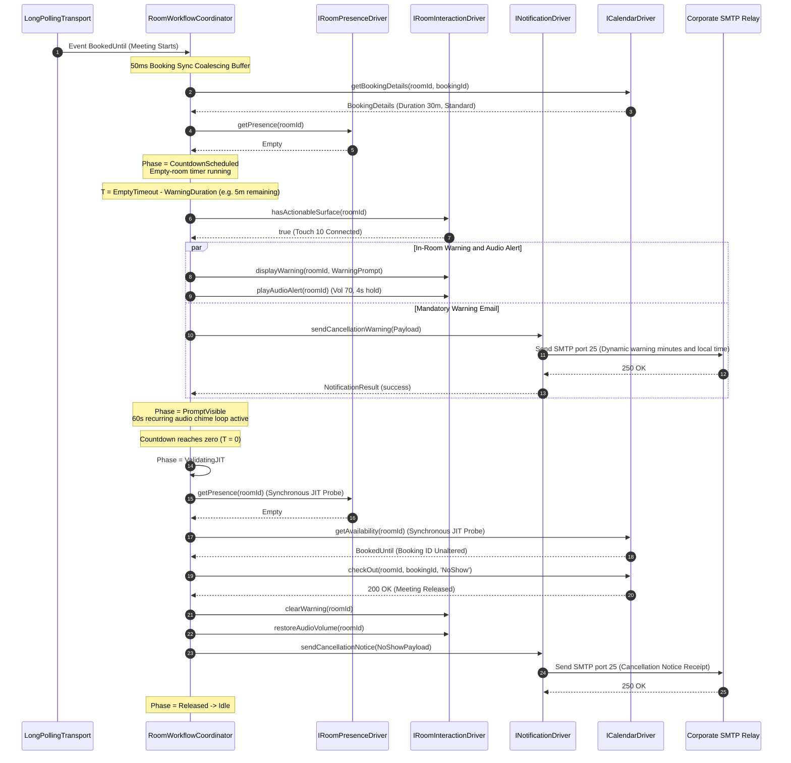
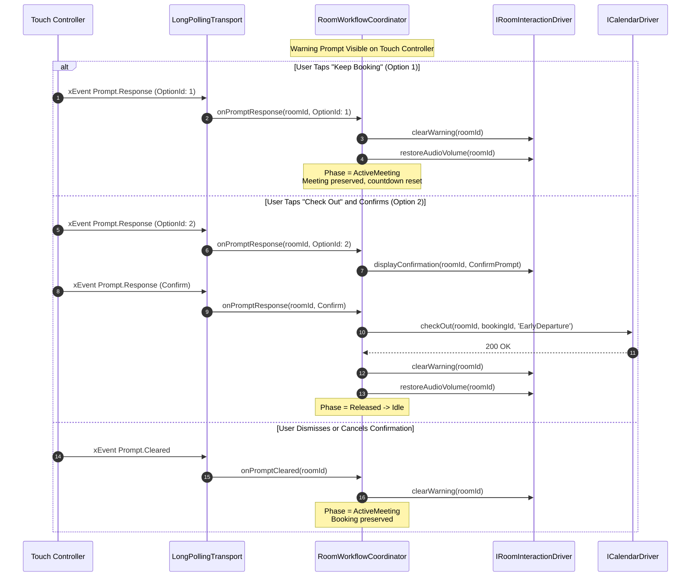
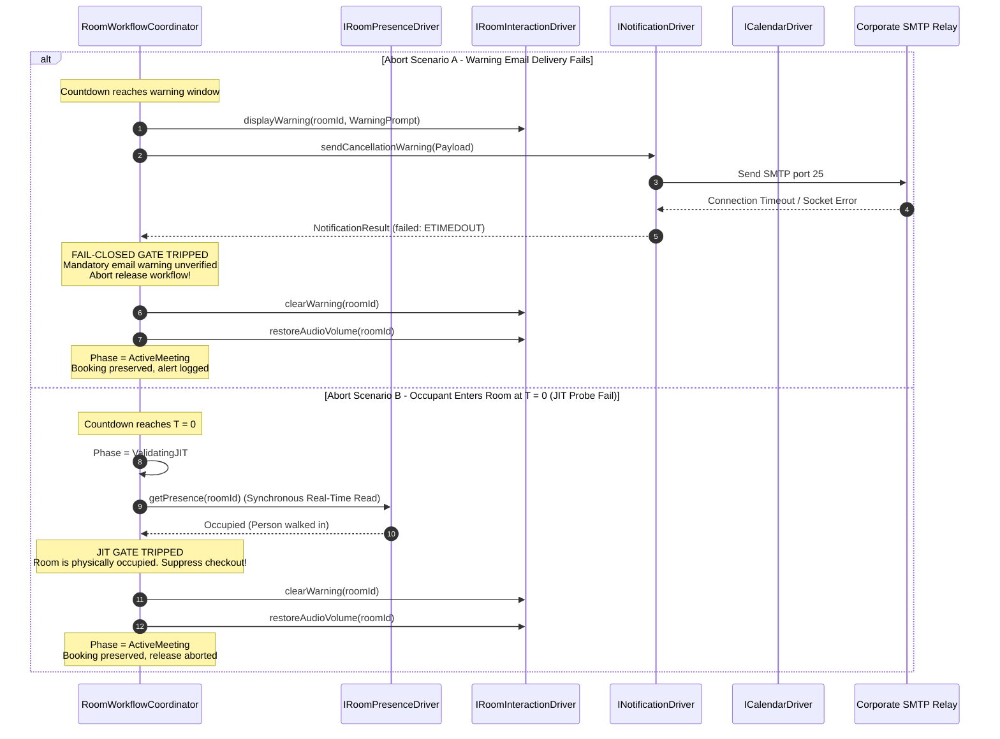

# Booking Auto Cancellation Service - Low-Level Design (LLD)

## 1. Document Purpose and Architectural Conformance

This document specifies the concrete Low-Level Design (LLD) for the centralized Booking Auto Cancellation external service.

It defines the runtime data structures, class interfaces, type signatures, finite state machine transition matrices, concurrency queues, and execution sequence diagrams required to implement the system specified in [service/docs/ServiceHighLevelDesign.md](service/docs/ServiceHighLevelDesign.md), [service/docs/ServiceMasterSpec.md](service/docs/ServiceMasterSpec.md), and [service/docs/ServiceDomainDrivenDesign.md](service/docs/ServiceDomainDrivenDesign.md).

---

## 2. Domain Types & Outbound Port Contracts

### 2.1 Core Domain Enums & Value Types

```typescript
export type RoomPresenceState = 'Occupied' | 'Empty' | 'Unknown';

export type RoomLifecyclePhase =
  | 'Idle'
  | 'Quarantined'
  | 'ActiveMeeting'
  | 'CountdownScheduled'
  | 'PromptVisible'
  | 'ValidatingJIT'
  | 'Released';

export type OperatingMode = 'MONITOR_ONLY' | 'DRY_RUN' | 'LIVE';

export type ExemptionClassification =
  | 'Eligible'
  | 'LongMeeting'
  | 'VipOrganizer'
  | 'TitleKeyword'
  | 'Unclassifiable';

export type CancellationReason = 'NoShow' | 'EarlyDeparture';

export interface BookingDetails {
  readonly id: string;
  readonly title: string;
  readonly organizerEmail: string;
  readonly organizerName: string;
  readonly startTime: Date;
  readonly endTime: Date;
  readonly isBookedFromDevice: boolean;
}

export interface RoomAvailabilitySnapshot {
  readonly status: 'Free' | 'FreeUntil' | 'BookedUntil';
  readonly timeStamp: Date;
  readonly until?: Date;
}
```

### 2.2 Hexagonal Outbound Ports (Driver Contracts)

```typescript
// --- 1. PRESENCE TELEMETRY PORT ---
export interface PresenceChangeEvent {
  readonly roomId: string;
  readonly presence: RoomPresenceState;
  readonly timestamp: Date;
}

export interface IRoomPresenceDriver {
  getPresence(roomId: string): Promise<RoomPresenceState>;
  onPresenceChange(handler: (event: PresenceChangeEvent) => void): void;
}

// --- 2. IN-ROOM INTERACTION PORT ---
export interface WarningPromptRequest {
  readonly title: string;
  readonly text: string;
  readonly durationSeconds: number;
  readonly option1Text: string; // 'Keep Booking'
  readonly option2Text: string; // 'Check Out'
}

export interface ConfirmationPromptRequest {
  readonly title: string;
  readonly text: string;
  readonly durationSeconds: number;
  readonly confirmOptionText: string; // 'Check out'
  readonly cancelOptionText: string;  // 'Cancel'
}

export interface PromptDisplayResult {
  readonly displayedOnController: boolean;
  readonly displayedOnOsd: boolean;
}

export interface PromptResponseEvent {
  readonly roomId: string;
  readonly promptId: string;
  readonly optionId: '1' | '2';
}

export interface PromptClearedEvent {
  readonly roomId: string;
  readonly promptId: string;
}

export interface IRoomInteractionDriver {
  hasActionableSurface(roomId: string): Promise<boolean>;
  displayWarning(roomId: string, prompt: WarningPromptRequest): Promise<PromptDisplayResult>;
  displayConfirmation(roomId: string, prompt: ConfirmationPromptRequest): Promise<PromptDisplayResult>;
  clearWarning(roomId: string): Promise<void>;
  restoreDismissedPrompt(roomId: string, prompt: WarningPromptRequest): Promise<void>;
  playAudioAlert(roomId: string): Promise<void>;
  restoreAudioVolume(roomId: string): Promise<void>;
  onPromptResponse(handler: (event: PromptResponseEvent) => void): void;
  onPromptCleared(handler: (event: PromptClearedEvent) => void): void;
}

// --- 3. CALENDAR OPERATIONS PORT ---
export interface CheckedInEvent {
  readonly roomId: string;
  readonly bookingId: string;
  readonly timestamp: Date;
}

export interface ICalendarDriver {
  getAvailability(roomId: string): Promise<RoomAvailabilitySnapshot>;
  getBookingDetails(roomId: string, bookingId: string): Promise<BookingDetails | null>;
  checkIn(roomId: string, bookingId: string, trackingData?: string): Promise<void>;
  checkOut(roomId: string, bookingId: string, reason: CancellationReason): Promise<void>;
  onCheckedIn(handler: (event: CheckedInEvent) => void): void;
}

// --- 4. DEVICE CONFIGURATION PORT ---
export interface IDeviceConfigDriver {
  enforceBaselinePresenceConfig(roomId: string): Promise<boolean>;
  enforceNativeCheckInWindow(roomId: string, windowMinutes: number): Promise<boolean>;
  setNativeCheckInEnabled(roomId: string, enabled: boolean): Promise<boolean>;
}

// --- 5. END-USER NOTIFICATION PORT ---
export interface CancellationWarningPayload {
  readonly roomId: string;
  readonly roomName: string;
  readonly organizerEmail: string;
  readonly organizerName: string;
  readonly meetingTitle: string;
  readonly warningMinutes: number; // Dynamically computed from PRE_TIMEOUT_WARNING_MS
  readonly scheduledReleaseLocalTime: string; // Formatted in codec-local timezone
}

export interface CancellationNoticePayload {
  readonly roomId: string;
  readonly roomName: string;
  readonly organizerEmail: string;
  readonly organizerName: string;
  readonly meetingTitle: string;
  readonly releaseTime: Date;
  readonly reason: CancellationReason; // 'NoShow' | 'EarlyDeparture'
}

export interface NotificationResult {
  readonly success: boolean;
  readonly messageId?: string;
  readonly error?: string;
}

export interface INotificationDriver {
  sendCancellationWarning(payload: CancellationWarningPayload): Promise<NotificationResult>;
  sendCancellationNotice(payload: CancellationNoticePayload): Promise<NotificationResult>;
}

// --- 6. DRIVING INGRESS TRANSPORT PORT ---
export interface IEventIngressTransport {
  start(): Promise<void>;
  stop(): Promise<void>;
  onNotification(handler: (payload: unknown) => void): void;
}
```

---

## 3. Core Room State Machine & Workflow Coordinator

Each managed room is encapsulated by a `RoomWorkflowCoordinator` (RoomActor) executing as an in-memory stateful actor.

### 3.1 Actor Internal State Model

```typescript
export interface RoomActorState {
  readonly roomId: string;
  roomName: string;
  operatingMode: OperatingMode;
  phase: RoomLifecyclePhase;

  // Generational Identity Counters (Race Condition Guards)
  bookingLifecycleId: number;
  releaseWorkflowId: number;

  // Active Booking Metadata
  currentBooking: BookingDetails | null;
  exemptionStatus: ExemptionClassification;
  isAdHocBookedFromDevice: boolean;

  // Notification State
  warningEmailDispatched: boolean;
  promptRestorationCount: number;

  // Active Timers
  coalesceTimer: NodeJS.Timeout | null;
  countdownTimer: NodeJS.Timeout | null;
  warningPromptTimer: NodeJS.Timeout | null;
  chimeIntervalTimer: NodeJS.Timeout | null;

  // Hardware Metadata
  codecTimezoneOffsetMinutes: number | null;
  hasActionableSurfaceCache: boolean | null;
}
```

### 3.2 Finite State Machine (FSM) Transition Matrix

| Current Phase | Incoming Event | Guard Condition | Next Phase | Executed Side Effects |
| :--- | :--- | :--- | :--- | :--- |
| **Idle** | `BookedUntil` received | Service booted with meeting already underway | **Quarantined** | Flag `AwaitingStartupCheckIn`. Log quarantine audit. |
| **Idle** | `BookedUntil` received | Meeting starts cleanly; room is empty | **CountdownScheduled** | Start 50ms coalescing buffer. Classify exemption. Schedule empty-room countdown. |
| **Idle** | `BookedUntil` received | Meeting starts cleanly; room is occupied | **ActiveMeeting** | Schedule automatic check-in (3s delay) if not ad-hoc. |
| **Quarantined** | `CheckedIn` received | Matches `bookingLifecycleId` | **ActiveMeeting** | Clear quarantine flag. Transition to standard active monitoring. |
| **Quarantined** | `PresenceChanged(Empty)` | In quarantine | **Quarantined** | **Suppressed.** No release action permitted. |
| **ActiveMeeting** | `PresenceChanged(Empty)` | `EARLY_DEPARTURE_RELEASE_ENABLED == true` | **CountdownScheduled** | Initialize new `releaseWorkflowId`. Start early-departure countdown timer. |
| **ActiveMeeting** | `PresenceChanged(Occupied)` | In meeting | **ActiveMeeting** | Maintain active meeting state. |
| **CountdownScheduled** | `PresenceChanged(Occupied)` | Any | **ActiveMeeting** | Cancel countdown timer. Reset `releaseWorkflowId`. Preserve booking. |
| **CountdownScheduled** | Countdown timer reaches warning threshold | Actionable surface verified; Duration $> 12$m; Not exempt | **PromptVisible** | `displayWarning()`, `playAudioAlert()`, start 60s chime loop, `sendCancellationWarning()`. If email fails $\to$ abort release. |
| **CountdownScheduled** | Countdown timer reaches warning threshold | No actionable surface OR Duration $\le 12$m OR Exempt | **ActiveMeeting** | Cancel workflow. Preserve booking. Log exemption reason. |
| **PromptVisible** | `PromptResponse(KeepBooking)` | Matches active `releaseWorkflowId` | **ActiveMeeting** | `clearWarning()`, restore audio volume, stop 60s chime loop. Reset countdown. |
| **PromptVisible** | `PromptResponse(CheckOut)` | Matches active `releaseWorkflowId` | **PromptVisible** | Display confirmation prompt (`displayConfirmation`). |
| **PromptVisible** | `Confirmation(Confirmed)` | Matches active `releaseWorkflowId` | **Released** | Synchronous JIT Probe $\to$ `ICalendarDriver.checkOut()`. |
| **PromptVisible** | `PromptCleared` (dismissed) | Warning window has time remaining | **PromptVisible** | `restoreDismissedPrompt()`. Do NOT resend warning email (`warningEmailDispatched == true`). |
| **PromptVisible** | `PresenceChanged(Occupied)` | Occupant entered room | **ActiveMeeting** | `clearWarning()`, restore audio volume, stop chime loop. Preserve booking. |
| **PromptVisible** | Warning timer reaches zero | Room remained vacant throughout warning | **ValidatingJIT** | Halt chime loop. Execute synchronous real-time JIT verification probe. |
| **ValidatingJIT** | JIT Probe returns `Empty` & Booking unaltered | Mandatory warning email verified sent | **Released** | Call `ICalendarDriver.checkOut()`. Dispatch `sendCancellationNotice()`. |
| **ValidatingJIT** | JIT Probe returns `Occupied` or `Unknown` | Late physical entry or sensor fault | **ActiveMeeting** | Abort release. Preserve booking. Log `ReleaseAbortedPreserved`. |
| **Released** | Availability becomes `Free` | Release completed | **Idle** | Reset room actor state to baseline. Clear all timers. |

---

## 4. Execution Sequence Diagrams

### 4.1 Sequence 1: Standard No-Show Release Workflow



---

### 4.2 Sequence 2: In-Room User Interaction ("Keep Booking" vs "Check Out")



---

### 4.3 Sequence 3: Fail-Closed Safety Precondition Aborts



---

## 5. Concurrency Control & Algorithmic Specifications

### 5.1 Generational Lifecycle Guard Algorithm

To eliminate asynchronous race conditions from stale xEvents arriving out of order:

1. Every time a new meeting or schedule transition occurs on a room, `actorState.bookingLifecycleId` is incremented.
2. Every time a new countdown or warning sequence begins, `actorState.releaseWorkflowId` is incremented.
3. Every asynchronous handler (prompt responses, timer callbacks, background probes) captures its originating IDs:

   ```typescript
   function handleWarningTimerExpired(capturedLifecycleId: number, capturedWorkflowId: number): void {
     if (
       capturedLifecycleId !== actorState.bookingLifecycleId ||
       capturedWorkflowId !== actorState.releaseWorkflowId
     ) {
       // Stale event from older meeting or aborted workflow; drop silently
       return;
     }
     executeJitVerificationAndRelease();
   }
   ```

### 5.2 50ms Booking Sync Coalescing Buffer

Rapid bursts of availability status (`Bookings.Availability.Status = BookedUntil`) and timestamp events are debounced using a 50ms sliding timer:

```typescript
function onAvailabilityStatusChanged(roomId: string, status: RoomAvailabilitySnapshot): void {
  const actor = registry.get(roomId);
  if (actor.coalesceTimer) {
    clearTimeout(actor.coalesceTimer);
  }
  actor.coalesceTimer = setTimeout(async () => {
    actor.coalesceTimer = null;
    await actor.synchronizeBookingDetails();
  }, 50);
}
```

### 5.3 5-Step Bounded Readiness Recovery Schedule

If initial metadata is missing (`Bookings.Current.Id` is null or `Bookings.Get` fails), the coordinator executes a bounded retry schedule on delays of `[250ms, 500ms, 1000ms, 2000ms, 4000ms]`:

- Step 1 to 4: Retries `Bookings.Get({ Id })`.
- Step 5: Falls back to `Bookings.List({ ScheduleType: 'Current', Limit: 1 })`.
- If Step 5 fails, the meeting is marked `UnclassifiableMeeting` and preserved (fails closed).

### 5.4 Serialized FIFO Promise Queue for Hardware Configuration

Writes to `Bookings.CheckIn.Enabled` must be strictly serialized to prevent asynchronous races on the physical endpoint:

```typescript
class DeviceConfigQueue {
  private queue: Promise<void> = Promise.resolve();

  enqueue(operation: () => Promise<void>): Promise<void> {
    const next = this.queue.then(async () => {
      try {
        await operation();
      } catch (err) {
        logger.error({ err }, 'Failed serialized device config write');
      }
    });
    this.queue = next;
    return next;
  }
}
```

---

## 6. Corporate SMTP Notification & Template Engine

### 6.1 Dynamic Duration Calculation

Warning emails calculate the remaining window directly from configuration:

$$\text{warningMinutes} = \operatorname{Math.round}\left(\frac{\text{PRE\_TIMEOUT\_WARNING\_MS}}{60\,000}\right)$$

The impended cancellation clock time is formatted using the physical room codec's local ISO timezone offset (e.g. `+10:00` for Brisbane, `+11:00` for Sydney AEDT).

### 6.2 Multipart MIME Template Specifications

#### Cancellation Warning Email (Dispatched at Countdown Warning)

- **Subject**: `[Action Required] Room Release Warning: ${roomName}`
- **HTML Body**: Clean, responsive layout detailing:
  - Meeting Title and Room Name.
  - Notice that the room is detected as vacant.
  - Statement: *"This reservation will be automatically released in **${warningMinutes} minutes** (at **${scheduledReleaseLocalTime}**) unless physical occupancy is detected or confirmed on the room controller."*
  - Bulleted instructions:
    - If you are using the room: Occupy the space or tap **Keep Booking** on the touch screen.
    - If you no longer need the room: Tap **Check Out** on the touch controller or do nothing to allow automatic release.
- **Plain-Text Alternative**: Exact text synchronization for plain-text email clients.

#### Cancellation Notice Email (Dispatched Post-Release)

- **Subject**: `Room Reservation Released: ${roomName}`
- **HTML Body**:
  - Differentiated Header based on `reason`:
    - **NoShow**: *"Your reservation was released because no physical presence was detected after meeting start."*
    - **EarlyDeparture**: *"Your reservation was released early because the room was vacated prior to scheduled end time."*
  - Room name, scheduled meeting time, and release timestamp.
  - Informational note that the room has been returned to the corporate pool for colleagues to book.

---

## 7. In-Memory Fleet Registry Architecture

The service manages ~800 room actors in Node.js heap memory:

```typescript
export class RoomRegistry {
  private readonly rooms = new Map<string, RoomWorkflowCoordinator>();

  get(roomId: string): RoomWorkflowCoordinator | undefined {
    return this.rooms.get(roomId);
  }

  register(roomId: string, coordinator: RoomWorkflowCoordinator): void {
    this.rooms.set(roomId, coordinator);
  }

  unregister(roomId: string): void {
    const actor = this.rooms.get(roomId);
    if (actor) {
      actor.teardown(); // Clears all active timers
      this.rooms.delete(roomId);
    }
  }

  getAll(): RoomWorkflowCoordinator[] {
    return Array.from(this.rooms.values());
  }
}
```

- **Memory Overhead**: Each `RoomWorkflowCoordinator` instance consumes $\approx 15\text{ KB}$ of RAM. Across 800 rooms, total fleet memory is $\approx 12\text{ MB}$, well within standard Node.js heap limits.
- **Teardown Safety**: `teardown()` guarantees all active `NodeJS.Timeout` and `Interval` handles are cleared immediately to prevent memory leaks.
